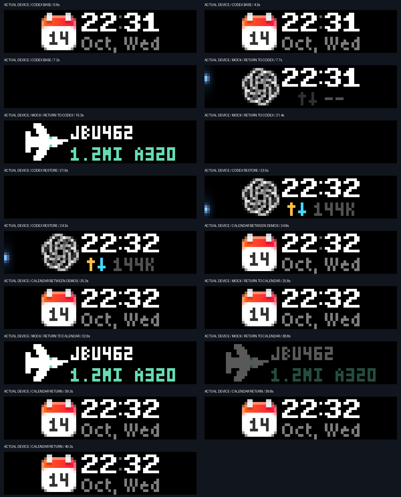

# BUSY Bar Checkers

Show Codex task status and nearby aircraft on one BUSY Bar.
One background service controls both checkers.
The original device calendar remains the default view.

| Directory | Contents |
|---|---|
| [codex-checker](codex-checker/README.md) | Codex lifecycle, ChatGPT/Your dot icons, clock, and network rate. |
| [adsbao-checker](adsbao-checker/README.md) | Mac location, ADSBao traffic, and nearby-aircraft alerts. |
| [shared](shared/README.md) | BUSY API, Keychain, button input, pixel text, native encoding, and fades. |

## Screen behavior

Send a new local Codex task to show its status.
A completed task shows standby for ten seconds, then restores the calendar.
Start/Pause also restores the calendar until the next task turn.

An aircraft within three statute miles can show a temporary alert.
The aircraft flies in beside its identity, distance, and type.
The alert remains visible for ten seconds, then fades out.
The service then restores the latest Codex view or the original calendar.
Start/Pause can dismiss the alert early.



These actual device frames use mock flight data.
They are not evidence of a real nearby flight.

## Install

Requirements: macOS, Python 3.10 or later, the Swift compiler, and a connected BUSY Bar.
Run all commands from the repository root.

1. Create the environment.

   ```sh
   python3 -m venv .venv
   ```

2. Install the package.

   ```sh
   .venv/bin/python -m pip install -e .
   ```

3. Compile the cloud credential helper.

   ```sh
   swiftc scripts/store-token.swift -o .venv/bin/busy-token-store
   ```

4. Compile the local input helper.

   ```sh
   swiftc scripts/input-keychain.swift -o .venv/bin/busy-input-keychain
   ```

5. Store the cloud token in Keychain.

   ```sh
   .venv/bin/busy-bar token-set
   ```

6. Configure Wi-Fi button input.

   ```sh
   .venv/bin/busy-bar input-wifi
   ```

7. Enable the aircraft checker with system location.

   ```sh
   .venv/bin/busy-bar adsbao-location
   ```

8. Allow Busy Bar Location in the native macOS dialog.

9. Install the background service.

   ```sh
   .venv/bin/busy-bar install
   ```

The service starts now and at login.
The Codex checker works without aircraft location setup.
Use `install --reduced-motion` for static lights and aircraft.

Keep the Mac awake and connected to the internet.
The Bar also needs an internet connection.
Local button input needs a working local connection to the Bar.

## Check status

```sh
.venv/bin/busy-bar status
.venv/bin/busy-bar adsbao-status
```

Status reports location quality and connection health without printing coordinates.
See each checker's README for detailed setup and diagnostics.

## Run tests

```sh
.venv/bin/python scripts/run-tests.py
```

This command runs the shared and both checker suites.
CI runs on Python 3.10 and 3.14.

## Credentials and location

Cloud and local BUSY tokens stay in macOS Keychain.
The precise location and configuration stay in the private runtime directory:
`~/Library/Application Support/BusyBarAI`.
Runtime directories use mode 0700; state files use mode 0600.
Rounded location coordinates are sent to adsbao.dev to select a nearby stream.
Do not commit that directory or add a token to a command argument.

The service clears only its own `ai-status` display namespace.
Device focus modes keep their higher priority.

Writing style: [ASD-STE100 Simplified Technical English](https://www.asd-ste100.org/).
