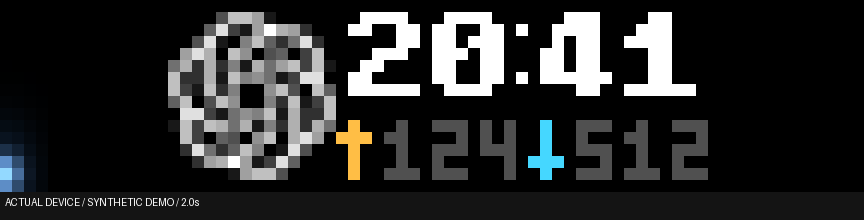

# busy-bar-toys

English | [简体中文](README.zh-CN.md)

Show local AI agent status and short notifications on a BUSY Bar.
One background service collects data from local apps.
The device calendar is the default view.

## Cloud control plane

[Open BUSY Traffic Control (BTC)](https://btc.orriduck.workers.dev).
Sign in with a BUSY device API token.
The Cloudflare backend controls the Bar.
Each Mac sends local status and notifications to its registered services.
The backend continues to schedule content after you close the browser.
SSE sends state updates to open management pages.

| Page | Use |
|---|---|
| **Display** | See actual device pixels, the current message, and waiting messages. |
| **Services** | Add services, connect local sources, and enable or disable each service. |
| **Configuration** | Move your services between priority groups. Set Hold and Heartbeat. |
| **Device** | Check connection, the current controller, and preview diagnostics. Sign out here. |

The queue marks the current message with a progress line.
A rotation strip shows background services that take turns.
New messages enter the list. Removed messages fade out.
Expand a row to see its content, source, full IDs, and available actions.

Services use compact cards under each computer.
The setup guide provides a command to connect a local source.
Creating a service does not start a local app.
Other computers stay visible and read only.

| Global group | Behavior |
|---|---|
| **Interception** | Interrupt either lower group. Keep the interrupted message for later. |
| **Follow queue** | Process messages in arrival order. Resume after an interruption. |
| **Dispensable** | Show background status when higher groups are empty. Rotate services by Hold. |

Services in one group have equal priority, across all computers.
Row order does not create another priority.
Drag only your own services between groups.
Group changes save immediately.
Hold and Heartbeat changes require **Save changes**.

**Hold** sets a background service's turn and a timed message's total visible time.
**Heartbeat** sets the allowed interval between service check-ins.
The sender declares whether a message ends by time or by its source.
The sender also decides when to send a new occurrence.
Agent status and requests for approval or input use separate services.

The interface supports light, dark, and automatic themes.
Mobile pages use a floating navigation bar with icons.
You can add BTC to the Home Screen as a PWA.

Live preview requires a configured Wi-Fi bridge and an enabled **Live preview** switch.
Its target is 30 fps. Device shows measured rates.
A preview failure does not stop cloud scheduling.

<details>
<summary>See the current interface with local mock data</summary>

These captures use simulated services and a simulated device.
They do not show a real device connection.


| Configuration | Services |
|---|---|
|  |  |

</details>

To connect a Mac, use the [client setup guide](docs/cloud-mode.md).
Register Agent status and Agent requests before you start the cloud observer.
The guide includes enrollment, browser pairing, source routes, and migration.
A Codex-only Mac does not need Claude hooks.

For a simulated device, use the [shared preview](https://busy-bar-control-plane-preview.orriduck.workers.dev) with `demo-token`.
Use synthetic data only in that preview.
See the [management guide](control-plane/README.md) and [protocol](control-plane/PROTOCOL.md).
The [Install](#install) steps below use standalone mode.

## Watch the use cases

The following archived clips use synthetic events and offline rendering.
They do not need a device, credentials, or enabled integrations.
Each archived clip has a `DEMO / OFFLINE RENDER` label.

Some clips predate the current token rates and cloud scheduling.
Use the current instructions for those behaviors.
The calendar is an illustration. Native text scrolling is approximate.
Download an MP4 to pause or replay a clip locally.

| | |
|---|---|
| **Codex: run → approval → standby → calendar** · [MP4](docs/demos/codex-cycle.mp4)<br> | **ADSBao: aircraft → current Codex task** · [MP4](docs/demos/adsbao.mp4)<br> |
| **Your dot: dedicated source icon** · [MP4](docs/demos/your-dot.mp4)<br> | **Start/Pause → calendar → new task turn** · [MP4](docs/demos/start-pause.mp4)<br> |
| **Clock and numeric animation** · [MP4](docs/demos/clock-tokens.mp4)<br> | **Running, approval, error, stale, standby** · [MP4](docs/demos/state-colors.mp4)<br> |

The Codex clip includes the full ten-second standby period.
The aircraft clip includes the full ten-second flight display.
Other notification holds are shortened to three seconds.
Urgent demo conditions clear after three seconds; real urgent items stay until resolved.

<details>
<summary>More demos: every optional app, static mode, and shared display</summary>

| | |
|---|---|
| **Claude Code: optional hooks** · [MP4](docs/demos/claude.mp4)<br> | **Reduced motion: static states** · [MP4](docs/demos/reduced-motion.mp4)<br> |
| **Datadog: urgent page and monitor alert** · [MP4](docs/demos/datadog.mp4)<br> | **GitHub: review, CI, changes and PR activity** · [MP4](docs/demos/github.mp4)<br> |
| **Jira: newly assigned ticket** · [MP4](docs/demos/jira.mp4)<br> | **Metaflow: failed run** · [MP4](docs/demos/metaflow.mp4)<br> |
| **Terminal: command succeeds or fails** · [MP4](docs/demos/terminal.mp4)<br> | **Credentials: login needs renewal** · [MP4](docs/demos/credentials.mp4)<br> |
| **Calendar app: upcoming meeting** · [MP4](docs/demos/calendar.mp4)<br> | **Shared Bar: urgent owner and waiting host** · [MP4](docs/demos/shared-display.mp4)<br> |

</details>

Optional app demos do not enable those apps on your Mac.
Claude Code requires its hooks only if you choose to use it.
The shared-display clip illustrates the ownership rule with a scripted sequence.
It does not test a second Mac.
See the [demo index, limits, and regeneration command](docs/demos/README.md).
See the [actual-device mock capture](docs/images/actual-staggered-intro.png) for separate hardware evidence.

## Components and apps

| Component | Display | Apps |
|---|---|---|
| [Agent checker](agent-checker/README.md) | Task status, source icon, clock, and token rates. | Codex, Your dot, Claude Code |
| [Notifier](notifier/README.md) | Short alerts with staggered character rolls. | ADSBao, Datadog, GitHub, Jira, Metaflow, Terminal, Credentials, Calendar |

See [all apps and their requirements](apps/README.md).

### Agent status

Start a task in a configured agent app to show its status.
The clock uses New York time in 24-hour format.
The amber ↑ value shows input tokens per second.
The cyan ↓ value shows output tokens per second.
These are token rates, not network speeds or task totals.

Both values describe the latest completed reply: its tokens divided by its elapsed time, including first-token latency and thinking.
The value stays until the next reply completes. It is not live decoding speed.

Input includes new input and first-time cache writes.
It excludes cache reads.
Output includes reasoning tokens.

Claude Code reports reply timing. Codex shows `--` until its reply timing is verified.
`--` means that the rate is unknown.
The program does not estimate missing usage.
The front display uses compact values.
The back display shows whole tokens per second.

Changed digits roll upward and then release their overlay.
A completed roll cannot cover a later value.

The capture below shows a finite DEMO on a real Bar.
All displayed times and rates are synthetic.
Original task frames are excluded.
This is a sampled recording, not a frame-rate measurement.



See the [numeric overlay lifecycle](docs/digit-overlay-lifecycle.md).

| Light | State |
|---|---|
| Moving blue | The task is in progress. |
| Yellow | The task needs input or approval in standalone mode. |
| Thin white | The task is complete or stopped. |
| Red | The task reported an error. |
| Gray | The last task update is more than 30 minutes old. |

In cloud mode, approval and input requests use the separate **Agent requests** Notifier.
Other active tasks can continue to report status.

After ten seconds in standby, the service restores the calendar.
Press Start/Pause to restore the calendar immediately.
The next task turn restores the agent display.

### Nearby aircraft

The Mac supplies its system location.
The service receives nearby traffic from [ADSBao](https://adsbao.dev) through Server-Sent Events (SSE).
The trigger distance is three statute miles, or 4,828 metres, measured horizontally.

The aircraft enters beside `ADSBAO`.
After half a second, characters roll upward to the flight identity from left to right.
Adjacent characters start about 67 milliseconds apart.
The lower line shows only the aircraft type, such as `A320`.

The full introduction takes about 1.77 seconds.
The flight identity then stays visible for ten seconds.
The service restores the current agent display or the calendar.
Each aircraft alerts once per encounter.

### Notifications

Built-in notifications use the aircraft entrance with an app icon.
The icon background uses the app color, or red for urgent items.
The detail text and LED show the level.
Red means urgent. Amber means attention. The app accent means information.

By default, timed notifications return after ten seconds.
Cloud mode uses the configured Hold value.
By default, urgent items stay until their condition clears or their action succeeds.
Start/Pause runs the action of an urgent item, for example a Datadog page acknowledgement.
On other items, Start/Pause dismisses all notifications and shows the calendar.
See the [notifier rules](notifier/README.md).

## Requirements

- macOS with Python 3.10 or later.
- Apple command-line tools with `swiftc` and `xcrun`.
- A BUSY Bar with internet access and a BUSY cloud API token.
- A local Wi-Fi or USB connection for Start/Pause input.

Keep the Mac awake and connected to the internet.
Wi-Fi button input requires local access between the Mac and the Bar.
The devices can use different Wi-Fi bands if the network permits this access.

## Install

These steps install standalone mode.
For cloud mode, follow the [client setup guide](docs/cloud-mode.md).
Keep `--mode cloud` on cloud installation and status commands.
Installing without that option selects standalone mode.

Keep this checkout after installation.
The service runs from its Python environment.
The command name remains `busy-bar`.

1. Clone the repository.

   ```sh
   git clone https://github.com/orriduck/busy-bar-toys.git
   ```

2. Open the repository directory.

   ```sh
   cd busy-bar-toys
   ```

3. Create the Python environment.

   ```sh
   python3 -m venv .venv
   ```

4. Install the package in editable mode.

   ```sh
   .venv/bin/python -m pip install -e .
   ```

5. Compile the cloud credential helper.

   ```sh
   swiftc scripts/store-token.swift -o .venv/bin/busy-token-store
   ```

6. Compile the button credential helper.

   ```sh
   swiftc scripts/input-keychain.swift -o .venv/bin/busy-input-keychain
   ```

7. Create a token on the [BUSY cloud token page](https://cloud.busy.app/api-tokens).

8. Store the token in macOS Keychain.

   ```sh
   .venv/bin/busy-bar token-set
   ```

9. Install the background service.

   ```sh
   .venv/bin/busy-bar install
   ```

The service starts immediately and at login.
Run the remaining commands from the repository directory.
After a directory move, repeat the editable installation and service installation.

## Enable Wi-Fi button input

1. Configure the Bar's local connection.

   ```sh
   .venv/bin/busy-bar input-wifi
   ```

2. Allow Keychain access if macOS requests it.

3. Restart the background service.

   ```sh
   .venv/bin/busy-bar install
   ```

The setup command reads the device address and stores the local token in Keychain.
On an agent or aircraft view, press Start/Pause to show the calendar.
For urgent notifications, see the action rule above.

## Enable aircraft alerts

1. Start system location setup.

   ```sh
   .venv/bin/busy-bar adsbao-location
   ```

2. Allow location access for **Busy Bar Location** in the macOS dialog.

3. Restart the background service.

   ```sh
   .venv/bin/busy-bar install
   ```

An ADSBao API key is not required.
The checker rejects old locations, inaccurate locations, stale aircraft positions, and aircraft on the ground.
See [aircraft setup and encounter rules](apps/src/busybar_apps/adsbao/README.md) for details.

## Enable notifications

1. Read the README of each [notifier app](apps/README.md) and install its tools.

2. Create the private configuration file.

   ```sh
   ${EDITOR:-vi} ~/Library/Application\ Support/BusyBarAI/notifier.json
   ```

3. Add one key for each app, for example `{"github": {}, "terminal": {}}`.

4. Restart the background service.

   ```sh
   .venv/bin/busy-bar install
   ```

Check the `notifier` key in `.venv/bin/busy-bar status`.
Run `.venv/bin/busy-bar notify-demo` to see each notification type. Stop the service first.

## Share one Bar between Macs

Use BTC to coordinate multiple Macs.
Each Mac has its own computer credential and registered services.
A paired browser can change only that computer's services.
All computers use the same three global priority groups.
Do not run a standalone writer on a Mac after it moves to cloud mode.
See [enrollment and migration](docs/cloud-mode.md).

Standalone mode has a separate device-storage lease.
It lets one notification own the display at a time.
Urgent notifications can interrupt lower-level notifications.
That lease does not provide the BTC queue or its three global groups.

## Check or stop the service

| Action | Command |
|---|---|
| Check standalone components | `.venv/bin/busy-bar status` |
| Check aircraft diagnostics | `.venv/bin/busy-bar adsbao-status` |
| Use static displays | `.venv/bin/busy-bar install --reduced-motion` |
| Restore animation | `.venv/bin/busy-bar install` |
| Stop the service | `.venv/bin/busy-bar uninstall` |

For cloud mode, use `.venv/bin/busy-bar status --mode cloud`.
Restart it with `.venv/bin/busy-bar install --mode cloud`.
For static cloud displays, add `--reduced-motion`.

In standalone mode, check `service_running` and `button_input.connected`.
Use `adsbao-status` for aircraft diagnostics.
Status output shows connection health and location accuracy.
The log is at `~/Library/Logs/BusyBarAI/service.log`.
Uninstalling the service retains the Keychain credentials.

## Update this checkout

Run these steps from a checkout of `main`.
Keep the existing computer identity, routes, and credentials for a normal update.
Do not enroll the computer again.

1. Stop the observer.

   ```sh
   .venv/bin/busy-bar uninstall
   ```

2. Get the current main branch without rewriting local commits.

   ```sh
   git pull --ff-only
   ```

3. Update the package.

   ```sh
   .venv/bin/python -m pip install -e .
   ```

4. Run the Python checks.

   ```sh
   .venv/bin/python scripts/run-tests.py
   ```

5. Start the observer in its previous mode.

   | Previous mode | Command |
   |---|---|
   | Cloud | `.venv/bin/busy-bar install --mode cloud` |
   | Standalone | `.venv/bin/busy-bar install` |

## Show a mock aircraft

This procedure uses standalone mode.
It sends synthetic content to the device.
Do not run a direct device demo beside an active cloud writer.

1. Stop the background service.

   ```sh
   .venv/bin/busy-bar uninstall
   ```

2. Play the finite aircraft demonstration.

   ```sh
   .venv/bin/busy-bar adsbao-demo
   ```

3. Start the background service again.

   ```sh
   .venv/bin/busy-bar install
   ```

The rear display labels the demonstration `DEMO`.
To create a preview without device access, run this command:

```sh
.venv/bin/busy-bar adsbao-preview --output .local/aircraft-preview
```

## Data and credentials

The service reads local agent event metadata.
BUSY cloud requests carry display images, animations, and device commands.
The aircraft connection sends rounded coordinates to ADSBao.
The exact location stays in a private local file.

| Data | Storage |
|---|---|
| Cloud token | Keychain service `app.busybar.ai-status`. |
| Local button token | Keychain service `app.busybar.local-input`. |
| Location, configuration, and events | `~/Library/Application Support/BusyBarAI`. |
| Service registration | `~/Library/LaunchAgents/app.busybar.ai-status.plist`. |

Runtime directories use mode `0700`.
Private state files use mode `0600`.
Keep tokens and runtime files outside Git.

Standalone mode uses the `ai-status` display namespace.
Cloud mode uses `busy-control`.
Each mode clears only its own namespace.
Source credentials stay on the Mac.
The cloud backend stores the encrypted BUSY device token.
Device focus modes retain their higher priority.

## Development

| Directory | Purpose |
|---|---|
| `shared` | Device API, Keychain, button input, display lease, text, and animation components. |
| `agent-checker` | Agent task registry, event spool, status display, and transitions. |
| `notifier` | Notification queue, background sources, entrance, and presenter. |
| `apps` | Agent apps and notifier apps. |
| `service` | Command line, launchd service, and cloud publishers. |
| `control-plane` | Cloudflare scheduler, device dispatcher, management UI, and mock backend. |
| `scripts` | Native helper builds, tests, and previews. |
| `docs` | Design records and device captures. |

Run all tests:

```sh
.venv/bin/python scripts/run-tests.py
```

CI runs the suite on Python 3.10 and 3.14.
Add focused tests for code changes and run this suite before a pull request.
Keep mock data clearly identified in previews and demonstrations.

See the [agent checker](agent-checker/README.md), the [notifier](notifier/README.md), the [apps](apps/README.md), [shared components](shared/README.md), and [motion verification](docs/weighted-motion.md).

## Sources

- [BUSY HTTP API](https://docs.busy.app/bar/dev/http-api).
- [Native font source and license](shared/src/busybar_shared/assets/font-source.txt).
- [Icon notices](apps/src/busybar_apps/NOTICE.md).
- Writing principles: [ASD-STE100 Simplified Technical English](https://www.asd-ste100.org/).

This project is independent of BUSY, OpenAI, and ADSBao.

## Game indicators

[Gaming setup](apps/src/busybar_apps/gaming/README.md) adds separate WoW, WoW Forever, and MapleStory services. They start in the Dispensable group. Open a supported game client to show **GAMING**, then its English name and elapsed client-open time. Close the client to withdraw its activity. Equal services rotate by Hold.
