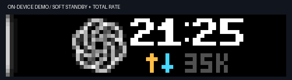

# BUSY Bar · AI Status

把 AI 的工作状态放到桌面的 BUSY Bar 上。

普通 ChatGPT/Codex 任务显示 ChatGPT 图标；Your dot 使用原创五点图标。前屏使用与 BUSY 原生时钟相同的点阵字体，显示纽约时间（24 小时制、自动夏令时），图标、时钟和紧凑网速在左侧状态光条以外的区域居中排列。上行箭头为暖橙色，下行箭头为青蓝色，数字保持灰色。前后屏都不显示 WORK / WAIT 等状态文字。背屏标明上下行的完整单位。

图标和时钟之间只留一列空隙，与原生日历的紧凑布局一致。网速行精简为「↑↓ 总速度」，完整放在时钟下方。上行有流量时 ↑ 亮暖橙色，下行有流量时 ↓ 亮青蓝色；没有流量或尚未获得采样时，箭头为暗灰色。图标和时钟位置固定。

最左侧四列显示发光状态条：工作时，亮核与渐弱蓝色光晕上下往复，由设备原生动画以 30 fps 播放，一次完整往返约 3.1 秒。时钟与状态仍每 5 秒刷新，不需要用频繁的云端绘图驱动动画。



| 状态 | 前屏 | 含义 |
|---|---|---|
| working | 左侧蓝色往复光条 | 任务正在执行 |
| waiting | 左侧黄色静止光条 | 任务正在等待输入或权限 |
| done | 全高柔白细光条 | 本轮结束，进入 standby |
| error | 左侧红色静止光条 | 收到任务级错误事件 |
| stopped | 全高柔白细光条 | 用户中断了本轮任务，进入 standby |
| unknown | 左侧灰色静止光条 | 30 分钟没有收到新事件，不推断已完成 |

网速来自**运行后台程序的这台 Mac 的默认网络接口**，每 5 秒按实际字节计数差更新，不发起测速下载。前屏只显示上行加下行的合计速度；背屏仍分别显示 UP / DN。前屏 B/K/M/G 分别简写 B/s、KiB/s、MiB/s、GiB/s。首次采样、网络切换、计数重置或读数失败时显示 `--`，有效采样后恢复。网速不是 BUSY Bar 本身的流量或网络带宽上限。

## Start / Pause 与原生日历

任务结束或中断后，先显示全高柔白 standby 细光条和时钟网速；**持续 10 秒后自动恢复设备原本的日历**。单列亮芯带淡光晕，两端渐暗，避免形成厚重白边。从成功显示 standby 开始计时，重复刷新不延长时间；期间有活跃任务则取消倒计时。回日历后，直到下一轮新任务开始才重新显示 Codex。自动返回使用现有云端绘图连接，不依赖按键通道。

**按键通道支持 Wi-Fi**。Mac 和 BUSY Bar 之间需要允许局域网直连，`status` 中 `button_input.transport=wifi` 且 `button_input.connected=true` 才表示已接通。云端绘图正常不代表按键通道可用；BAR cloud token 不能打开这个本地事件流。未配置 Wi-Fi 时，程序仍可监听 USB 地址 `10.0.4.20`。

连接后，按 Start / Pause 会停止本程序绘图，恢复设备原本的日历；直到**下一轮新任务**开始才重新显示 Codex。旧任务的思考、批准、完成和心跳更新都不会抢回屏幕。日历模式保存在私有运行目录，重启程序后仍然有效。

留在 Codex 界面时，蓝色上下浮动表示思考，黄色静止光表示等待批准/输入，完整高度的柔白细光条表示 standby（没有活跃任务、本轮完成或用户中断）。错误和未知状态仍分别保留红色与灰色，避免误报为 standby。

## 目前能自动跟踪什么

**本机 Codex Desktop / CLI：**增量读取 `~/.codex/sessions` 中的生命周期事件，只提取会话 ID、轮次 ID、来源、项目文件夹名和时间。子 agent 不单独占屏。工具命令失败不会被误报为整个任务失败。用户输入工具可提供 WAIT；原生权限等待可通过下面的可选 hooks 明确上报。

**Your dot：**从 Codex 本地显式 Orbit 身份元数据识别 dot 会话，或通过 `--dot-thread` 指定身份。仅有身份元数据时不会点亮工作状态。**纯云端 Your dot 没有本地生命周期事件，不能由此后台程序自动跟踪**；可用 `emit --source dots` 从 dot 的本地执行环境桥接真实事件。云端缓存里的 `active` 表示身份存续，不表示正在工作。

本项目不读取网页 ChatGPT 对话状态，不推断任何云端任务已完成。Codex 会话日志是兼容适配器，并非稳定公共接口；升级后可用 hooks 或显式 `emit` 作为事件来源。

## 安装（macOS）

需要 Python 3.10+、Swift 编译器和联网的 BUSY Bar。

```sh
python3 -m venv .venv
.venv/bin/python -m pip install -e .
swiftc scripts/store-token.swift -o .venv/bin/busy-token-store
swiftc scripts/input-keychain.swift -o .venv/bin/busy-input-keychain
.venv/bin/busy-bar token-set
.venv/bin/busy-bar status
.venv/bin/busy-bar input-wifi
.venv/bin/busy-bar install
```

`token-set` 隐藏输入，只通过 stdin 把 token 交给 macOS Security framework。token 放在钥匙串的 `app.busybar.ai-status` 条目中；不写入源码、配置文件、命令行参数或日志。首次 `/usr/bin/security` 读取可能弹出钥匙串授权提示，需要你手动允许。

`input-wifi` 通过已绑定设备的云端 API 获取当前局域网地址，为按键流创建并复用专用本地 token，保存到钥匙串 `app.busybar.local-input`。运行目录里的 `input.json` 只保存设备地址，权限 0600。该命令不会修改设备已有的本地访问模式或密码。DHCP 地址变化后重新运行该命令，再运行 `install` 即可更新。配置成功只表示配置已保存，实时连通以 `status` 为准。

`install` 安装当前用户的 LaunchAgent，立即启动并在登录后运行。它不会改动 Codex 的通知配置、hooks 信任配置、设备计时、亮度、声音、账户或网络设置。观察程序退出后，画面最多保留 15 秒；连接出错会退避重试，token 被拒绝则停止而不是反复认证。

```sh
# 查看真实设备连接和后台服务状态
.venv/bin/busy-bar status

# 停止并移除自动启动；保留钥匙串条目
.venv/bin/busy-bar uninstall

# 手动运行；只改变该会话使用的来源图标
.venv/bin/busy-bar watch --dot-thread YOUR_DOT_THREAD_ID
```

后台日志：`~/Library/Logs/BusyBarAI/service.log`，只记录状态词和通用连接错误。事件缓冲：`~/Library/Application Support/BusyBarAI/events`，目录权限 0700，文件权限 0600。

## 事件桥接

外部脚本应围绕**同一轮真实任务**使用同一个 session 和 turn ID：

```sh
.venv/bin/busy-bar emit working --source dots --session-id YOUR_DOT_THREAD_ID --turn-id RUN_ID --project my-project
.venv/bin/busy-bar emit waiting --source dots --session-id YOUR_DOT_THREAD_ID --turn-id RUN_ID --project my-project
.venv/bin/busy-bar emit done --source dots --session-id YOUR_DOT_THREAD_ID --turn-id RUN_ID --project my-project
```

事件命令只在本机写入元数据，后台程序再发送显示数据。云端 dot 必须能够在这台 Mac 执行命令才能使用这条桥；没有本地访问时不声称已接通。

### 可选 Codex hooks

`busy-bar hook` 从 stdin 消费官方 hooks JSON，把 `UserPromptSubmit` / `PreToolUse` / `PostToolUse` 映射为 WORK，`PermissionRequest` 映射为 WAIT，`Stop` 映射为 DONE，`Interrupt` 映射为 STOP。

将下面片段**合并**到你已有的 `~/.codex/hooks.json` 的 `hooks` 对象，替换命令中的绝对路径。不要覆盖已有 hooks。对上面六种事件分别配置同样的 handler：

```json
{
  "hooks": {
    "PermissionRequest": [
      {
        "hooks": [
          {
            "type": "command",
            "command": "/ABSOLUTE/PATH/busy-bar/.venv/bin/busy-bar hook",
            "timeout": 3
          }
        ]
      }
    ]
  }
}
```

按 Codex 的正常流程审核并信任新增 hook。程序不修改信任记录、不绕过审核。hook 丢弃 prompt、tool_input 和工具输出，且不做网络请求，避免拖慢任务。

## 预览与演示

```sh
.venv/bin/busy-bar preview --output .local/preview

# 先停掉观察程序，防止真实状态覆盖演示
.venv/bin/busy-bar uninstall
.venv/bin/busy-bar demo --source dots --state waiting --seconds 5
.venv/bin/busy-bar install

# 读取设备实际像素（用于验证，不是本地模拟图）
.venv/bin/busy-bar capture --output .local/device
```

演示背屏明确标记 DEMO。前屏 72×16 RGB；背屏 160×80 OLED。中文项目名在 Mac 上渲染为图片，不依赖设备的 ASCII 字体。

## 屏幕共存

只使用 `application_name=ai-status`，清理时只删除本应用元素。显示优先级为 50；内置 BUSY/CUSTOM 专注阶段是 90，所以专注时收到 HTTP 409 会正常让出屏幕。其他同优先级应用可能覆盖画面；本程序不改变它们的设置。所有显示元素 15 秒后自动失效，每 5 秒刷新。

## 验证与来源

```sh
.venv/bin/python -m unittest discover -s tests -v
```

测试覆盖真实事件状态机、跨轮次乱序、部分 JSONL 写入、过期状态、来源识别、并发优先级、XPM2 尺寸、权限冲突、定向清理与错误脱敏。

接口核查：2026-10-14，BUSY Bar 固件 1.2.4 / API 27.5.0。

验收记录：[初版](docs/verification.md)、[时钟与往复动画](docs/clock-and-animation.md)、[原生时钟与网速](docs/clock-and-network.md)、[居中布局与发光条](docs/centered-glow.md)、[按键与 standby](docs/button-calendar.md)、[10 秒自动回日历](docs/standby-timeout.md)、[柔和待机与合计网速](docs/compact-standby.md)。

- [BUSY HTTP API](https://docs.busy.app/bar/dev/http-api)
- [固件 1.2.4 OpenAPI](https://api.busy.app/busybar/openapi.yaml?Name=1.2.4)
- [硬件规格](https://docs.busy.app/bar/tech-specs)
- [Codex hooks](https://learn.chatgpt.com/docs/hooks)
- [ChatGPT 官方图标来源](https://help.openai.com/en/articles/7905742-what-does-the-official-chatgpt-ios-app-icon-look-like)

ChatGPT 图标归 OpenAI 所有，仅用来识别对应任务；本项目并非 OpenAI 或 BUSY 官方产品。五点 Your dot 标记为本项目原创。
