# busy-bar-toys

[English](README.md) | 简体中文

在 BUSY Bar 上显示本机 AI agent 状态和简短通知。
一个后台服务运行所有 app。
设备原生日历是默认界面。

## 云端 control plane

可选的 Cloudflare 后端统一协调多台 Mac 的显示服务。
浏览器分为 Display、Services、Configuration 和 Device 四页。
Display 只显示真实正面画面和 App / Sender / Received 三列队列。
可选的本地 Wi-Fi 预览桥以 30 fps 为目标，Device 显示实际测量帧率。
Configuration 使用 Interception、Follow queue、Dispensable 三个全局组。每台电脑只能移动自己的服务，并设置分组、Hold 和 Heartbeat；同组服务同级，行序不影响调度。Services 提供服务开关。
每条消息由发送端声明结束方式。定时消息显示完成后结束，宿主决定何时再次发送。
本地采集器使用独立服务凭证发布画面，管理页通过 SSE 同步。

打开[正式管理页](https://btc.orriduck.workers.dev)，用 BUSY 设备 API token 登录。每台 Mac 使用独立的发布凭据注册。

可以用 `demo-token` 进入[云端预览](https://busy-bar-control-plane-preview.orriduck.workers.dev)。共享演示仅使用模拟数据，请勿接入真实采集器。仓库也提供本地演示。
参见[管理页指南](control-plane/README.zh-CN.md)、[本地客户端接入](docs/cloud-mode.zh-CN.md)和[协议](control-plane/PROTOCOL.md)。
原有独立安装仍是默认模式。

## 看演示

这些循环短片使用模拟事件与项目现有的绘制代码。
生成演示无需设备、凭据或已启用的集成。
每段都有 `DEMO / OFFLINE RENDER` 标记。
日历为示意图，原生文字的滚动为近似模拟。
需要暂停或重播时，可下载 MP4 在本地播放。

| | |
|---|---|
| **Codex：运行 → 批准 → 待机 → 日历** · [MP4](docs/demos/codex-cycle.mp4)<br>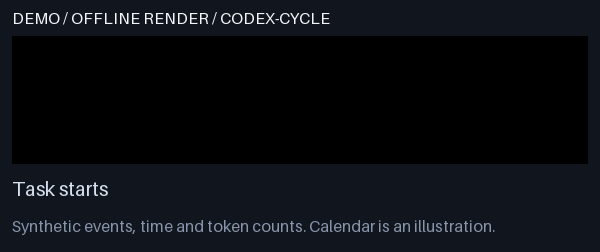 | **ADSBao：飞机提示 → 恢复当前 Codex** · [MP4](docs/demos/adsbao.mp4)<br>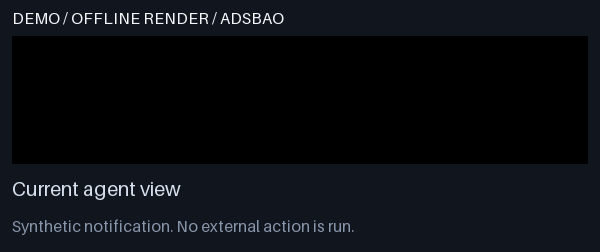 |
| **Your dot：独立来源图标** · [MP4](docs/demos/your-dot.mp4)<br>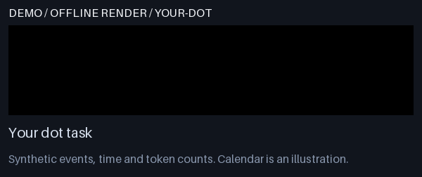 | **Start/Pause → 日历 → 新一轮任务** · [MP4](docs/demos/start-pause.mp4)<br>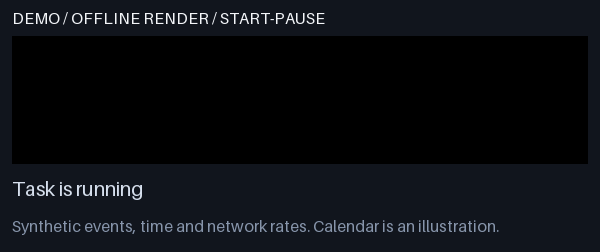 |
| **时钟与输入／输出 token** · [MP4](docs/demos/clock-tokens.mp4)<br>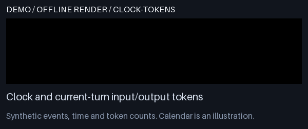 | **运行、批准、错误、过期、待机** · [MP4](docs/demos/state-colors.mp4)<br>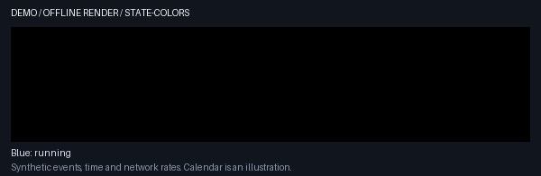 |

Codex 短片保留完整的十秒待机。
飞机短片保留完整的十秒航班显示。
其他通知的停留缩短为三秒。
紧急演示条件在三秒后解除；真实紧急通知会持续显示到解决。

<details>
<summary>更多演示：所有可选 app、静态模式与共享显示</summary>

| | |
|---|---|
| **Claude Code：可选 hooks** · [MP4](docs/demos/claude.mp4)<br>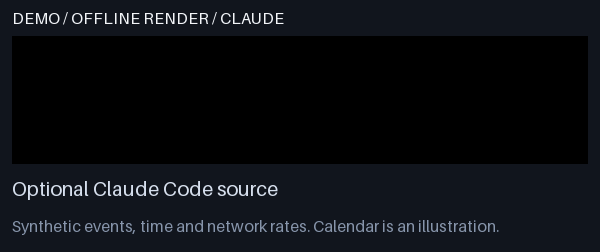 | **减少动态效果：静态状态** · [MP4](docs/demos/reduced-motion.mp4)<br>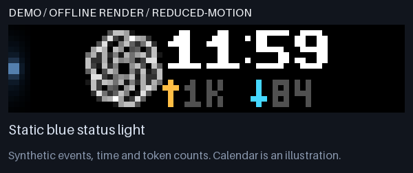 |
| **Datadog：紧急 page 与监控告警** · [MP4](docs/demos/datadog.mp4)<br> | **GitHub：评审、CI、修改要求与 PR 动态** · [MP4](docs/demos/github.mp4)<br> |
| **Jira：新分配的工单** · [MP4](docs/demos/jira.mp4)<br>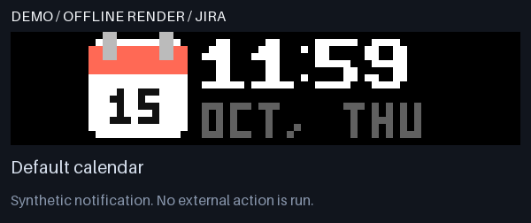 | **Metaflow：运行失败** · [MP4](docs/demos/metaflow.mp4)<br>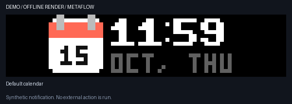 |
| **Terminal：命令成功或失败** · [MP4](docs/demos/terminal.mp4)<br> | **Credentials：登录需要续期** · [MP4](docs/demos/credentials.mp4)<br> |
| **Calendar app：即将开始的会议** · [MP4](docs/demos/calendar.mp4)<br> | **共享 Bar：紧急通知占用，另一主机等待** · [MP4](docs/demos/shared-display.mp4)<br>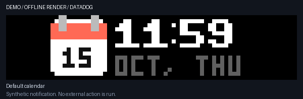 |

</details>

可选 app 的演示不会在你的 Mac 上启用这些 app。
只有选择使用 Claude Code 时，才需要配置它的 hooks。
共享显示短片使用脚本序列说明所有权规则，不代表两台 Mac 的实测。
见[演示索引、限制与重新生成命令](docs/demos/README.md#简体中文)。
另有[设备实测的模拟航班截图](docs/images/actual-staggered-intro.png)，可单独对照硬件效果。

## 组件与 app

| 组件 | 显示内容 | App |
|---|---|---|
| [Agent checker](agent-checker/README.md) | 任务状态、来源图标、时钟、每秒 token 速率。 | Codex、Your dot、Claude Code |
| [Notifier](notifier/README.md) | 带逐字滚动入场动画的简短通知。 | ADSBao、Datadog、GitHub、Jira、Metaflow、Terminal、Credentials、Calendar |

见[全部 app 及其要求](apps/README.md)。

### Agent 状态

在已配置的 agent app 中开始一个任务，即可显示状态界面。
时钟使用纽约时区和 24 小时制。
琥珀色 ↑ 数字表示输入 token，青色 ↓ 数字表示输出 token。
两个数字都是每秒 token 数，按最近 10 秒上报的用量计算。
Codex 和 Claude Code 都会上报用量；`--` 表示速率未知，例如刚开始的第一秒，或来源没有上报用量。
正面显示缩写，背面显示完整的每秒 token 数。

| 光条 | 状态 |
|---|---|
| 上下移动的蓝条 | 任务正在运行。 |
| 黄条 | 任务需要输入或批准。 |
| 细白条 | 任务已完成或停止。 |
| 红条 | 任务报告错误。 |
| 灰条 | 任务超过 30 分钟没有更新。 |

待机十秒后，服务恢复原生日历。
按 Start/Pause 可立即恢复日历。
下一轮任务开始时，服务重新显示 agent 界面。

### 附近飞机

Mac 提供系统定位。
服务通过 Server-Sent Events（SSE）连接接收 [ADSBao](https://adsbao.dev) 的附近飞机数据。
触发范围为三英里，约 4,828 米，按水平距离计算。

飞机图标先入场，旁边显示 `ADSBAO`。
停留半秒后，字符从左到右依次向上滚动，切成航班标识。
相邻字符错开约 67 毫秒。
下面一行只显示机型，例如 `A320`。

完整入场约需 1.77 秒。
航班标识随后保持十秒。
服务再恢复当前 agent 界面或原生日历。
同一架飞机在一次经过期间只提示一次。

### 通知

所有通知都使用飞机的入场动画，并显示 app 图标。
图标底色使用 app 自己的颜色，紧急项目用红色。详情文字和 LED 表示级别：红色为紧急，琥珀色为需要处理，app 强调色为一般信息。
其他通知十秒后自动恢复 agent 界面或日历。
紧急通知一直显示，直到情况解除或其动作成功。
按 Start/Pause 会执行紧急通知的动作，例如确认 Datadog page。
其他通知上按 Start/Pause，会清除全部通知并显示日历。
见 [notifier 规则](notifier/README.md)。

## 环境要求

- macOS，以及 Python 3.10 或更新版本。
- 包含 `swiftc` 和 `xcrun` 的 Apple 命令行工具。
- 已连接互联网的 BUSY Bar，以及适用于该设备的云端 API token。
- 供 Start/Pause 使用的 Wi-Fi 或 USB 本地连接。

保持 Mac 唤醒并连接互联网。
Wi-Fi 按键功能要求 Mac 与 Bar 在局域网内互通。
只要网络允许互通，两台设备可以使用不同的 Wi-Fi 频段。

## 安装

安装后保留本地仓库。
后台服务使用仓库内的 Python 环境运行。
命令名仍为 `busy-bar`。

1. 克隆仓库。

   ```sh
   git clone https://github.com/orriduck/busy-bar-toys.git
   ```

2. 进入仓库目录。

   ```sh
   cd busy-bar-toys
   ```

3. 创建 Python 环境。

   ```sh
   python3 -m venv .venv
   ```

4. 以可编辑模式安装软件包。

   ```sh
   .venv/bin/python -m pip install -e .
   ```

5. 编译云端凭据助手。

   ```sh
   swiftc scripts/store-token.swift -o .venv/bin/busy-token-store
   ```

6. 编译按键凭据助手。

   ```sh
   swiftc scripts/input-keychain.swift -o .venv/bin/busy-input-keychain
   ```

7. 在 [BUSY 云端 token 页面](https://cloud.busy.app/api-tokens)创建 token。

8. 将 token 存入 macOS 钥匙串。

   ```sh
   .venv/bin/busy-bar token-set
   ```

9. 安装后台服务。

   ```sh
   .venv/bin/busy-bar install
   ```

服务会立即启动，并在登录时自动运行。
后续命令均在仓库目录内执行。
移动目录后，重新执行可编辑安装和后台服务安装。

## 启用 Wi-Fi 按键

1. 配置设备的本地连接。

   ```sh
   .venv/bin/busy-bar input-wifi
   ```

2. 如果 macOS 请求访问钥匙串，选择允许。

3. 重启后台服务。

   ```sh
   .venv/bin/busy-bar install
   ```

配置命令读取设备地址，并将本地 token 存入钥匙串。
在 agent 或飞机界面，按 Start/Pause 可显示日历。
紧急通知的按键规则见上文。

## 启用飞机提示

1. 启动系统定位设置。

   ```sh
   .venv/bin/busy-bar adsbao-location
   ```

2. 在 macOS 弹窗中，允许 **Busy Bar Location** 使用定位。

3. 重启后台服务。

   ```sh
   .venv/bin/busy-bar install
   ```

此功能无需 ADSBao API key。
服务会过滤过期或精度不足的定位、过期飞机位置，以及地面飞机。
详细设置与去重规则见[飞机功能说明](apps/src/busybar_apps/adsbao/README.md)。

## 启用通知

1. 阅读每个 [notifier app](apps/README.md) 的 README，并安装所需工具。

2. 创建私有配置文件。

   ```sh
   ${EDITOR:-vi} ~/Library/Application\ Support/BusyBarAI/notifier.json
   ```

3. 为每个 app 添加一个键，例如 `{"github": {}, "terminal": {}}`。

4. 重启后台服务。

   ```sh
   .venv/bin/busy-bar install
   ```

在 `.venv/bin/busy-bar status` 中检查 `notifier` 键。
运行 `.venv/bin/busy-bar notify-demo` 可查看每种通知。请先停止服务。

## 多台 Mac 共用一个 Bar

多台 Mac 可以为同一个 Bar 运行此服务。
设备存储中的显示租约保证同一时间只显示一条通知。
另一台 Mac 显示通知时，非紧急通知排队等待。
紧急通知可以接管较低级别通知的显示。
已有紧急通知的主机会保留显示权，直到释放。
每台 Mac 都须运行相同版本。

## 检查或停止服务

| 操作 | 命令 |
|---|---|
| 检查全部组件 | `.venv/bin/busy-bar status` |
| 查看飞机诊断 | `.venv/bin/busy-bar adsbao-status` |
| 使用静态显示 | `.venv/bin/busy-bar install --reduced-motion` |
| 恢复动画 | `.venv/bin/busy-bar install` |
| 停止服务 | `.venv/bin/busy-bar uninstall` |

按已启用的功能，检查 `service_running`、`traffic.connected` 和 `button_input.connected`。
状态输出包含连接情况和定位精度。
日志路径为 `~/Library/Logs/BusyBarAI/service.log`。
停止并卸载后台服务后，钥匙串凭据仍会保留。

## 演示模拟航班

1. 停止后台服务。

   ```sh
   .venv/bin/busy-bar uninstall
   ```

2. 播放一次飞机演示。

   ```sh
   .venv/bin/busy-bar adsbao-demo
   ```

3. 重新启动后台服务。

   ```sh
   .venv/bin/busy-bar install
   ```

设备背屏会以 `DEMO` 标记演示。
如需生成无需连接设备的预览，执行下列命令：

```sh
.venv/bin/busy-bar adsbao-preview --output .local/aircraft-preview
```

## 数据与凭据

服务读取本机 agent 事件元数据。
BUSY 云端请求包含显示图像、动画和设备命令。
飞机数据连接会向 ADSBao 发送舍入后的坐标。
精确定位保存在本机私有文件中。

| 数据 | 保存位置 |
|---|---|
| 云端 token | 钥匙串服务 `app.busybar.ai-status`。 |
| 本地按键 token | 钥匙串服务 `app.busybar.local-input`。 |
| 定位、配置和事件元数据 | `~/Library/Application Support/BusyBarAI`。 |
| 后台服务注册 | `~/Library/LaunchAgents/app.busybar.ai-status.plist`。 |

运行时目录权限为 `0700`。
私有状态文件权限为 `0600`。
请勿将 token 或运行时文件提交到 Git。
服务仅清理自己的 `ai-status` 显示命名空间。
设备专注模式保留更高的优先级。

## 开发

| 目录 | 用途 |
|---|---|
| `shared` | 设备 API、钥匙串、按键、显示租约、文字和动画组件。 |
| `agent-checker` | Agent 任务登记、事件暂存、状态界面和过渡动画。 |
| `notifier` | 通知队列、后台来源、入场动画和显示控制。 |
| `apps` | Agent app 与 notifier app。 |
| `service` | 命令行、launchd 服务和显示协调。 |
| `scripts` | 原生助手构建、测试和预览。 |
| `docs` | 设计记录与设备截图。 |

运行全部测试：

```sh
.venv/bin/python scripts/run-tests.py
```

CI 使用 Python 3.10 和 3.14 运行测试。
修改代码时，添加有针对性的测试，并在提交拉取请求前运行全部测试。
预览和设备演示须明确标记模拟数据。

更多资料见 [agent checker](agent-checker/README.md)、[notifier](notifier/README.md)、[app](apps/README.md)、[共享组件](shared/README.md)和[动效验证](docs/weighted-motion.md)。

## 资料来源

- [BUSY HTTP API](https://docs.busy.app/bar/dev/http-api)。
- [原生字体来源与许可证](shared/src/busybar_shared/assets/font-source.txt)。
- [图标说明](apps/src/busybar_apps/NOTICE.md)。
- 英文写作原则：[ASD-STE100 Simplified Technical English](https://www.asd-ste100.org/)。

中文说明沿用英文版的短句、明确术语和单步操作结构。
本项目独立于 BUSY、OpenAI 和 ADSBao。
