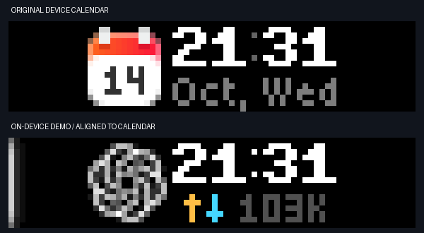

# Agent checker

Show the status of local AI agents on a BUSY Bar.
Each agent is an app that registers a source icon, a title, and a hook mapping.

| App | Source | Events |
|---|---|---|
| [Codex](../apps/src/busybar_apps/codex/README.md) | `chatgpt` | Local rollout files and optional hooks. |
| [Your dot](../apps/src/busybar_apps/dots/README.md) | `dots` | Orbit identity and lifecycle commands. |
| [Claude Code](../apps/src/busybar_apps/claude/README.md) | `claude` | Claude Code hooks. |

The front display shows the source icon, a clock, and input/output tokens per second.
The clock uses New York time and a 24-hour format.
The layout matches the device calendar.



## Read the display

| Indicator | Meaning |
|---|---|
| Moving blue light | A task is in progress. |
| Yellow light | A task needs input or approval. |
| Thin white light | The display is in standby. |
| Red light | A task reported an error. |
| Gray light | No task update arrived for 30 minutes. |
| Amber up arrow | Input tokens per second. |
| Cyan down arrow | Output tokens per second. |

The source icon identifies the agent app of the task.

The two numbers show input and output tokens per second for the selected session.
Each agent app reports cumulative session totals. The observer samples every live session about once a second, whether or not it is on screen.
The rate is the change in reported totals over the last 10 seconds of samples.
During the first 10 seconds of samples, the rate covers the observed span. It shows `--` until one second is observed.
A session with no new usage shows 0.
Input includes cached input. Output includes reasoning output.
Codex totals come from local rollout records. Claude Code totals come from its local transcript, read through the hook's transcript path. Only usage fields are read, never message text.
The back display shows the rates in whole tokens per second.

The front display uses decimal abbreviations: K means one thousand and M means one million.
Each rate has three characters. For example, `.1M` means 100,000 tokens per second.
Compact values are rounded down. The back display shows the unabbreviated rate.
`--` means that the rate is unknown: the source does not report usage, its usage became unavailable, or sampling is warming up.
A gap of more than 10 seconds between samples, unavailable usage, or a decrease in the source counter restarts sampling. The next rate warms up again; the program never shows a delta it did not observe within the window.
The program does not estimate missing usage.

## Return to the calendar

A completed or interrupted task enters standby.
After ten seconds, the program restores the device calendar.
A new task turn restores the Codex display.
Updates from an old turn do not restore it.

Start/Pause also restores the calendar when the local button connection is available.
Automatic return does not need this connection.

## Display transitions

The display fades in when a new task starts.
The light fades out before its color changes.
It then fades in with the new color.
An icon change uses the same sequence.
The clock stays visible during these changes.

Changed digits roll upward.
A change of count format fades the token field.
Repeated values do not restart an effect.
The device plays the animation frames from stored files.

Standby remains visible for ten seconds after its entrance effect.
The display then fades out and returns to the device calendar.

See the [transition settings and device captures](../docs/motion.md).

To use static lights and direct display changes, install with this option:

```sh
.venv/bin/busy-bar install --reduced-motion
```

Run `install` without this option to restore motion effects.

## Requirements

- macOS.
- Python 3.10 or later.
- The Swift compiler.
- A BUSY Bar with internet access.
- A cloud API token for that device.

## Install the program

Run these commands from the repository root, above this checker directory.

1. Create the Python environment.

   ```sh
   python3 -m venv .venv
   ```

2. Install the package.

   ```sh
   .venv/bin/python -m pip install -e .
   ```

3. Compile the cloud token helper.

   ```sh
   swiftc scripts/store-token.swift -o .venv/bin/busy-token-store
   ```

4. Compile the local input helper.

   ```sh
   swiftc scripts/input-keychain.swift -o .venv/bin/busy-input-keychain
   ```

5. Store the cloud token.

   ```sh
   .venv/bin/busy-bar token-set
   ```

6. Check the cloud connection.

   ```sh
   .venv/bin/busy-bar status
   ```

7. Install the background service.

   ```sh
   .venv/bin/busy-bar install
   ```

The service starts now and at login.
The first Keychain read can show a permission dialog.
Approve that dialog on the Mac.

## Configure Wi-Fi button input

The Mac must be able to connect to the BUSY Bar on the local network.
A cloud connection alone cannot receive button events.

1. Save the local input configuration.

   ```sh
   .venv/bin/busy-bar input-wifi
   ```

2. Restart the service.

   ```sh
   .venv/bin/busy-bar install
   ```

3. Check the input connection.

   ```sh
   .venv/bin/busy-bar status
   ```

The input connection is ready when `button_input.connected` is `true`.
The selected transport is in `button_input.transport`.
A saved configuration does not prove that the connection is ready.

The setup command creates or reuses a local access token.
It does not change the device access mode or password.
Run setup again if DHCP changes the device address.
Without Wi-Fi configuration, the program uses the USB address `10.0.4.20`.

## Check or stop the service

Show device and service status:

```sh
.venv/bin/busy-bar status
```

Remove the background service:

```sh
.venv/bin/busy-bar uninstall
```

This command keeps the Keychain entries.

Run the observer in a terminal:

```sh
.venv/bin/busy-bar watch
```

Service log: `~/Library/Logs/BusyBarAI/service.log`.
Private runtime directory: `~/Library/Application Support/BusyBarAI`.

## Send lifecycle events

Use one session ID and one turn ID for each real task turn.
Replace `SOURCE` with a registered source, such as `chatgpt`, `dots`, or `claude`.

```sh
.venv/bin/busy-bar emit working --source SOURCE --session-id SESSION --turn-id TURN --project my-project
.venv/bin/busy-bar emit done --source SOURCE --session-id SESSION --turn-id TURN --project my-project
```

`busy-bar hook --source SOURCE` reads one hook payload from standard input.
Each app README gives its hook mapping and configuration.

## Preview and capture

Create a local preview:

```sh
.venv/bin/busy-bar preview --output .local/preview
```

Stop the observer before a device demo:

```sh
.venv/bin/busy-bar uninstall
```

Show a five-second demo:

```sh
.venv/bin/busy-bar demo --source dots --state waiting --seconds 5
```

Show an 18-second transition demo:

```sh
.venv/bin/busy-bar motion-demo --seconds 18
```

This demo uses example clock values and synthetic token counts.
It does not change the device clock.

Start the observer after the demo:

```sh
.venv/bin/busy-bar install
```

Capture the actual device displays:

```sh
.venv/bin/busy-bar capture --output .local/device
```

The back display labels demos as DEMO.
A demo is not a task status report.

## Credentials and display ownership

The cloud token is in Keychain entry `app.busybar.ai-status`.
The local input token is in `app.busybar.local-input`.
Secrets pass through standard input or captured output.
The program does not put them in command arguments, configuration files, or logs.

Runtime directories use mode 0700.
State and event files use mode 0600.
The Wi-Fi configuration contains only the device address.

The program owns display namespace `ai-status` at priority 50.
It clears only that namespace.
Device focus modes have a higher priority.
An HTTP 409 response makes the program yield the display.
Display elements expire after 15 seconds without a refresh.
Connection failures use a bounded retry delay.
Authentication failures stop retries.

## Verification

Run the tests:

```sh
.venv/bin/python scripts/run-tests.py
```

Device checks used firmware 1.2.4 and API 27.5.0 on 2026-10-14.
See the [layout checks](../docs/centered-glow.md), [button checks](../docs/button-calendar.md),
[standby timeout check](../docs/standby-timeout.md), and [compact display check](../docs/compact-standby.md).
See the [motion check](../docs/motion.md) for transition captures.

## References

- [BUSY HTTP API](https://docs.busy.app/bar/dev/http-api).
- [Firmware 1.2.4 API schema](https://api.busy.app/busybar/openapi.yaml?Name=1.2.4).
- [Codex hooks](https://learn.chatgpt.com/docs/hooks).
- [Official ChatGPT icon](https://help.openai.com/en/articles/7905742-what-does-the-official-chatgpt-ios-app-icon-look-like).
- Writing style: [ASD-STE100 Simplified Technical English](https://www.asd-ste100.org/).

The ChatGPT icon belongs to OpenAI.
The five-dot mark is an original project asset.
This project is independent of OpenAI and BUSY.
