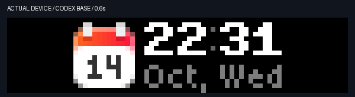

# ADSBao notifier app

Show an aircraft alert when a fresh airborne position is within three statute
miles of this Mac. Three miles equals 4,828.032 metres.
The distance is horizontal ground distance. It is not a nautical-mile limit.

ADSBao is an app on the [notifier](../../../../notifier/README.md).
It uses the public [ADSBao nearby stream](https://adsbao.dev).
It does not contact upstream aircraft providers directly.
It does not need an ADSBao API key.

## Alert behavior

The nearest new aircraft flies into view from the left edge.
The front display shows its callsign and aircraft type when available.
The flight identity uses the clock's native Bold7 font.
The aircraft enters in 300 ms. The title holds `ADSBAO` for 500 ms.
Characters roll upward to the flight identity from left to right.
Each character uses the clock digit's 500 ms damped roll.
Adjacent characters start two native frames (about 67 ms) apart.
The full introduction takes about 1.77 seconds, including space for eight characters.
The lower line shows only the aircraft type in native small text after the entrance. It stays blank if the type is unknown.
Reduced-motion mode shows the flight identity immediately.
A missing callsign uses the registration or ICAO hex identifier.
The back display shows aircraft details.

The alert stays visible for ten seconds after its entrance.
It then fades out. The notifier shows the next item, or restores the agent view or the device calendar.
Start/Pause dismisses it early and selects the calendar.

An aircraft alerts once per encounter.
It must remain beyond 3.5 miles for 60 seconds before it can alert again.
No more than one alert starts in a 30-second interval.
Encounter metadata survives a service restart.
The metadata contains identifiers and times, not coordinates.

Old, malformed, on-ground, or stale positions do not trigger alerts.
The maximum aircraft position age is 60 seconds.
An older position cannot replace a newer position for the same aircraft.
Unavailable traffic does not mean that the sky is empty.

## Enable system location

Run commands from the repository root.

1. Request native location setup.

   ```sh
   .venv/bin/busy-bar adsbao-location
   ```

2. Allow Busy Bar Location in the macOS dialog.

3. Restart the service.

   ```sh
   .venv/bin/busy-bar install
   ```

4. Check diagnostics.

   ```sh
   .venv/bin/busy-bar adsbao-status
   ```

Setup builds the native helper if it is missing.
An installed observer uses the helper without requesting authorization again.
Denied access leaves the calendar and the agent checker available.
After changing the system permission, run setup and reinstall the service.

The checker rejects location fixes older than five minutes.
It also rejects accuracy worse than 500 metres.
It does not use IP geolocation as a replacement.
The stream uses rounded coordinates; the local radius check uses the actual fix.

For an explicit fixed observation point, use
`adsbao-location --fixed LAT LON`, then reinstall the service.
This option saves that point privately. It is not automatic Mac location.
Run `adsbao-location` without this option to restore automatic location.

## Render a mock preview

```sh
.venv/bin/busy-bar adsbao-preview --output .local/adsbao-preview
```

This command does not read location, credentials, or the device.
It writes a contact sheet and a short 30 fps rendered GIF.

## Show a mock on the device

1. Stop the observer.

   ```sh
   .venv/bin/busy-bar uninstall
   ```

2. Run the finite mock.

   ```sh
   .venv/bin/busy-bar adsbao-demo
   ```

3. Restart the observer.

   ```sh
   .venv/bin/busy-bar install
   ```

The demo uses a published example observation point and a synthetic flight.
It does not change the saved observation point.
The back display says DEMO.
The demo refuses to run while the observer holds the display lock.

## Verification

Verified on 2026-10-14 with firmware 1.2.4 and API 27.5.0:

- Actual-device mock capture: 77 framebuffer samples.
- Aircraft entrance, stable details, fade, agent view restoration, and calendar restoration.
- Live ADSBao envelope parsing and cancellable stream shutdown.
- User-authorized native location with a valid 40-metre accuracy fix.
- A 135-second stationary check received four distinct native fix timestamps.
- All 155 local tests passed.



Cloud capture runs at about two samples per second.
It does not measure native playback frame rate.
Native animation files use 30 fps.
Cloud requests can add a pause between the outgoing fade and restored view.
The captures prove the mock screen flow; they do not prove a real aircraft passed
within three miles during verification.

The tests cover radius boundaries, position order, freshness, re-entry, persisted
suppression, native location validation, stream shutdown, reduced motion,
button dismissal, restoration, interrupted masks, and device retry delays.

See [native helper details](macos/README.md).
See the [bold type and weighted-motion check](../../../../docs/weighted-motion.md).
