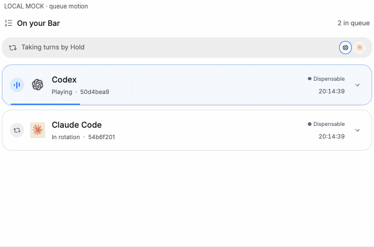
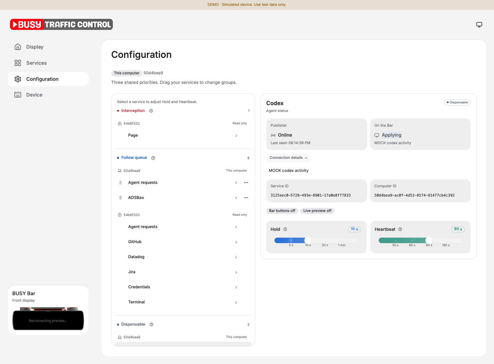
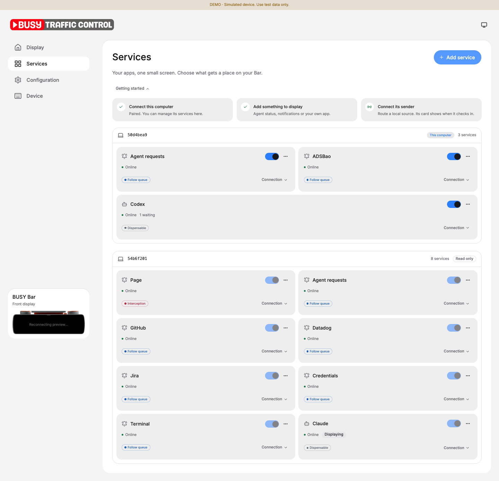

# BUSY Traffic Control

[简体中文](README.zh-CN.md) · [Protocol](PROTOCOL.md) · [Mac setup](../docs/cloud-mode.md)

Manage a BUSY Bar at [btc.orriduck.workers.dev](https://btc.orriduck.workers.dev).
The Cloudflare backend selects content and writes the display.
Each Mac collects local events and sends scenes to its registered services.
Closing the browser does not stop cloud scheduling.
SSE sends state updates to open management pages.

The interface uses React, Vite, Tailwind, and shadcn/ui with Base UI.
TanStack Query manages server state.
GSAP handles list and page transitions. Number Flow handles changing numbers.

## Read the pages

| Page | Purpose |
|---|---|
| **Display** | Actual front-display pixels, the current message, and waiting messages. |
| **Services** | Service cards, source setup, switches, and connection details. |
| **Configuration** | Three global groups, Hold, and Heartbeat. |
| **Device** | Device connection, current controller, API confirmation, and preview diagnostics. |

The queue shows the confirmed player first.
Other rows retain server order.
A progress line marks the current message.
The rotation strip represents services, including services with several messages.

New rows enter smoothly. Removed rows fade out.
Expand a row for content, full source IDs, receipt time, and available actions.

The short sender ID identifies the sending computer.
It does not identify the business author of a notification.
Received time includes seconds and remains unchanged when a message receives updates.
A selected message is not necessarily confirmed on the device.
An API acknowledgment alone does not prove physical pixels.

The preview stays available on other pages in a compact panel.
Mobile pages use a floating navigation bar with icons.
Appearance cycles through Automatic, Light, and Dark.
You can add BTC to the Home Screen as a PWA.
A PWA still needs a network connection for control and live data.

<details>
<summary>Current interface: local mock data</summary>

These captures show simulated services and a simulated device.
They do not establish real device connectivity.



| Configuration | Services |
|---|---|
|  |  |

</details>

## Connect a Mac

1. Sign in with a device-scoped BUSY API token.
2. Open **Services → Connect computer**.
3. Follow the [client setup guide](../docs/cloud-mode.md).
4. Register Agent status and a separate Agent requests Notifier.
5. Pair this browser with the computer.
6. Start the observer with `--mode cloud`.

The device token permits viewing all computers.
A server-side browser pairing permits changes to one computer's services.
Other computers remain visible and read only.
A browser preference cannot grant editing access.

The setup guide includes enrollment, optional sources, routes, and migration.
A Codex-only Mac does not need Claude hooks.
Registration does not start a collector or upload executable code.
A custom publisher uses [PROTOCOL.md](PROTOCOL.md).

## Add and control services

1. Open **Services**.
2. Select **Add service**.
3. Choose **Agent status**, **Notifications**, or **Your own app**.
4. Enter a name.
5. Select **Add service**.
6. Follow the source connection guide.

The form generates a service ID.
Advanced settings permit a custom ID.
The source guide provides `busy-bar cloud-route SOURCE SERVICE_ID`.
If `busy-bar` is not on PATH, use `.venv/bin/busy-bar` from the repository root.

Run it with the installed client on the paired Mac.
Then restart that Mac's cloud observer.
Creating a service alone does not connect a source.

Use the main switch to enable or disable a service.
Expand **Connection** for heartbeat details, IDs, **Bar buttons**, and **Live preview**.
Grant button and preview access only to the service that supplies each bridge.
Revoke, remove, and credential replacement remain separate operations.
Credential replacement ends that service's old items.
Update its local connection before it publishes again.

## Set global groups

| Group | Behavior |
|---|---|
| **Interception** | Interrupt lower groups. Retain interrupted work. |
| **Follow queue** | Process arrival order. Resume after an interruption. |
| **Dispensable** | Run when higher groups are empty. Alternate services by Hold. |

Group priority applies across computers.
Services in one group have equal priority.
Row order does not add another priority.
You can move only your own services between groups.
Use drag, the move menu, or keyboard controls.
A group change saves immediately.

Select a service to edit its timing.
The desktop layout keeps the group list and detail panel side by side.
Mobile pages show the list and detail separately.
Full IDs remain available in **Connection details**.

| Setting | Meaning |
|---|---|
| **Hold** | A background service's visible turn and a timed message's cumulative visible lifetime. |
| **Heartbeat** | The allowed interval between service check-ins. |

Use the snap sliders or edit their numeric values.
Select **Save changes** to save timing.
Select **Discard** to remove timing edits.
If the server rejects an old configuration, reload it before retrying.

Each sender declares `exit: finite` or `exit: source` per occurrence.
Finite time starts after entrance and pauses during interruption.
A source-ended message requires its host to end or withdraw it.
The host decides when to send a new occurrence.
There is no Exit or Later control in Configuration.

Agent status and approval or question requests use separate registrations.
Place status in Dispensable and requests in Follow queue.
Use Interception for a dedicated Page service that must interrupt lower groups.

## Connect the preview and buttons

Preview requires local Wi-Fi access between the designated Mac and the Bar.
Enable **Live preview** on that Mac's service in Services.
The bridge verifies device identity before reading the front framebuffer.
It sends actual pixels while a signed-in management page is visible.

Capture targets 30 fps. Device reports actual rates.
The browser buffer targets about 150 ms and holds at most six pending frames.
A missing preview bridge does not stop scheduling or device writes.
See [preview setup](../docs/cloud-mode.md#restore-a-disconnected-preview).

**Bar buttons** permits device-wide Start/Pause handling through the designated listener.
An ordinary publisher cannot clear another service's items.
Primary actions run on the original Mac.
Failed or unknown action results keep the notification.

Start/Pause runs the current urgent primary action when one exists.
Otherwise, it clears nonurgent items and requests the device calendar.
Urgent items survive that clear.

## Try a simulated device

The [shared preview](https://busy-bar-control-plane-preview.orriduck.workers.dev) accepts `demo-token`.
Use synthetic data only.
Do not connect real collectors or private source credentials to this public demo.
The preview uses separate storage and secret bindings.
Its simulated BUSY Worker cannot control a real device.

For a local demo, use Node 26 and npm.
Run these commands from the repository root:

```sh
cd control-plane
npm ci
npm run dev:demo
```

1. Open `http://localhost:8787`.
2. Sign in with `demo-token`.
3. Open Display to inspect the simulated device.
4. Open another page to check SSE updates.

The page shows **DEMO**. `/api/mode` reports `demo:true`.
Use `demo-blocked` or `demo-offline` to test display rejection or connection failure.

The simulated API rejects real device tokens.
Its local diagnostic state is at `http://localhost:8790/__demo/state`.
Stop the terminal process to stop local scheduling.
Ignored `.wrangler/` files retain local state.

## Run checks

Run from `control-plane`:

```sh
npm test
npm run typecheck
npm run build
npm run dry-run
```

Tests use the Workers runtime, SQLite Durable Objects, and simulated upstream HTTP.
A dry run packages the Worker. It does not deploy it.

Run the Python suite from the repository root:

```sh
.venv/bin/python scripts/run-tests.py
```

Tests do not establish physical pixels, production availability, or a two-Mac migration.
Use separate device checks for those results.

## Deploy your backend

Production uses the fixed BUSY cloud API origin.
Do not deploy a demo configuration or its public fixture secrets.

1. Set `PUBLIC_ORIGIN` to the site's exact HTTPS origin.
2. Set a fresh 64-character hex `TOKEN_ENCRYPTION_KEY` through Wrangler secrets.
3. Set a separate random `SESSION_SIGNING_KEY`.
4. Run `npm run types`.
5. Run the checks above.
6. Deploy the production configuration to your account.
7. Verify sign-in and scheduling before moving device writers.

`wrangler secret put NAME` reads the value from standard input.
It creates a deployed version.
Keep values out of command arguments, Git, and logs.

This project's production site uses Cloudflare Workers Builds connected to Git.
GitHub Actions runs checks separately.
Changes to other Macs require their own migration.
Do not revoke their active tokens during a staged migration.
See the [migration guide](../docs/cloud-mode.md#upgrade-an-existing-mac).

## Storage and failure rules

The backend verifies device identity and encrypts the BUSY token with AES-GCM.
Browser sessions use Secure, HttpOnly, SameSite cookies.
Computer credentials permit publishing only to services owned by that computer.
Legacy publisher credentials permit publishing to one service.
Source account credentials remain on the Mac.

SQLite stores queue state and command intent before device HTTP calls.
One dispatcher writes each device.
It checks the generation before each write.
Alarms handle expiry, retry, and renewal.

Normal handoff prepares the next scene before retiring old elements.
Cold recovery or unknown device state can require a full clear.
A capacity fallback can briefly show a dark display.
See [handoff limits](../docs/seamless-handoff.md).

Completed numeric rolls end with a transparent frame.
Old digits cannot cover later base updates.
See the [numeric overlay lifecycle](../docs/digit-overlay-lifecycle.md).

| Resource per device | Limit |
|---|---|
| Registered services | 32 |
| Live items / presentation JSON | 256 / 2 MiB |
| Live-item and replay-protection reservations | 4096 |
| Actions / button IDs / sessions / SSE clients | 512 / 2048 / 64 / 16 |
| Cloud assets | 64 files / 4 MiB; 256 KiB per file |
| Device assets | 16 fixed filenames / 2 MiB |
| Native element lease | At most 60 seconds |

Capacity errors are explicit.
The backend does not overwrite an asset that is playing.
A cloud outage does not make Macs write directly to the Bar.
Native elements expire, and the device calendar returns.
The original Mac's independent watchdog can provide urgent system notifications.
Sleep or denied notification permission can prevent that fallback.

Sign out ends the browser session and its pairing.
It does not stop the Mac observer or cloud scheduler.
