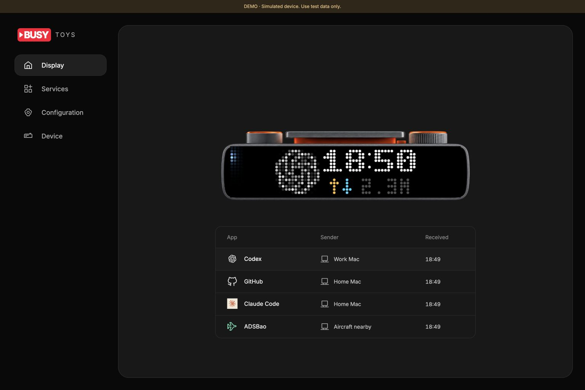

# BUSY Bar control plane

[中文](README.zh-CN.md) · [Protocol](PROTOCOL.md) · [Approved design](../docs/plans/control-plane-v5.md)

Manage one BUSY Bar from a browser. Register display services. Set their priority, exit rule and enabled state. See the current owner and every queued notification. The page receives full state snapshots through SSE.

The Cloudflare backend schedules the queue and writes the display. A local Mac collects Codex, Your dot and notification data. It sends complete scenes to the backend. Closing the browser does not stop cloud scheduling.

Open the [production management page](https://busy-bar-control-plane.orriduck.workers.dev) and sign in with your device-scoped BUSY API token. Production uses the real BUSY cloud API. It has separate storage and secret bindings from the preview.

The local demo and shared cloud preview use a simulated BUSY API. They cannot control a real device. Use `demo-token` only with the preview.



## Open the cloud preview

Open [the preview](https://busy-bar-control-plane-preview.orriduck.workers.dev) and enter `demo-token`. This is a shared public demo. Use synthetic data only. Do not connect real Mac collectors or source credentials to it. Hosted demo credential dialogs omit real-collector setup commands.

The preview has a separate SQLite namespace and fresh secret bindings. Its simulated BUSY Worker has no public route and no network egress. The production configuration has no simulated upstream binding.

## Run the local demo

Use Node 26 and npm. From the repository root:

```sh
cd control-plane
npm ci
npm run dev:demo
```

1. Open `http://localhost:8787`.
2. Enter `demo-token` in the device token field.
3. Open **Services**, then select **Register**.
4. Choose **Agent checker**, **Notifier** or **Custom publisher**.
5. Save the publisher credential. The page shows it once.
6. Connect a publisher with the command in the credential dialog.
7. Open a second browser page to check SSE updates.

The page shows **DEMO**. `/api/mode` reports `demo:true`. The mock API listens on port 8790. Its diagnostic state is at `http://localhost:8790/__demo/state`.

Use `demo-blocked` or `demo-offline` to test device rejection or loss of connection. These tokens select the same fake device. A real device token is rejected by the mock. The mock never forwards a request to BUSY.

Stop the terminal process to stop the local server. State remains in the ignored `.wrangler/` folder. Local scheduling stops with this process. Cloud scheduling after deployment uses Durable Object alarms.

## Connect local collectors

See the [local client guide](../docs/cloud-mode.md). Each role needs its own registered service and publisher credential. Keep the agent service below the notifier service in priority. The page starts new agent services at 10 and notifier services at 50.

Setup stores a connection. It does not change the installed standalone observer. Use explicit cloud mode only when you are ready to switch. This Mac does not need Claude hooks.

A custom publisher follows [PROTOCOL.md](PROTOCOL.md). Registering a service does not upload code for Cloudflare to execute.

## Use the management page

- **Display:** see current front-display pixels and the queue. Rows show App, Sender, and Received. Open an app to read details, expand grouped members, pause, resume, end, or run an advertised action.
- **Services:** register collectors. Replace or revoke publisher credentials here. Replacement ends that service's old items. Update the local client before it can publish again.
- **Configuration:** change enabled state, priority, exit rule, visible time, condition delay and heartbeat timeout. Select **Save changes**. A stale configuration is rejected. Reload the form before you try again.
- **Device:** inspect connection, current controller, API confirmation and preview diagnostics. Sign out here. An API acknowledgment does not prove physical pixels.

Sender is the service name, with an instance when needed. It is not the notification's business author. Received is the occurrence's first server receipt time. Updates retain it. Open the row for full provenance and time.

Enable **Live display preview bridge** in Configuration for one designated Mac service. Update that Mac and retain its existing local Wi-Fi input configuration. The bridge verifies the Bar identity and reads its actual front framebuffer. It sends pixels only while a signed-in Display page is visible. Capture targets 30 fps; Device reports actual rates. A missing bridge does not stop cloud scheduling. See [preview setup and limits](../docs/cloud-mode.md#management-pages-and-live-display).

**Trusted device button bridge** is a separate capability. Grant it only to the local input listener. It permits device-wide Start/Pause handling. An ordinary publisher cannot clear other services. Primary actions run on the original Mac. Failed or unknown results keep the notification.

Urgent groups use first-recognized order. They do not interrupt another urgent group. A normal wait behind a healthy urgent group does not trigger a system notification. The Mac watchdog still warns if display proof expires or the device fails.

Finite items count visible time after entry. An interruption pauses that time. Nonurgent standing conditions return after a delay if the source still confirms them. Defaults are 10 seconds visible and 30 minutes delayed. Manual clearing prevents the same occurrence from returning.

Start/Pause runs the current urgent primary action, when one exists. Otherwise it clears nonurgent items and requests calendar fallback. Urgent items survive that clear.

## Run checks

```sh
npm test
npm run typecheck
npm run build
npm run dry-run
```

Tests use the Workers runtime, SQLite Durable Objects and fake upstream HTTP. They cover scheduling, permissions, state recovery and dispatcher behavior. Type checking includes the browser code. A dry run packages the production Worker; it does not deploy it.

Run the Python suite from the repository root:

```sh
.venv/bin/python scripts/run-tests.py
```

Local tests do not verify real firmware visuals, animation timing, production availability or two-Mac migration. Acknowledged-command eviction is tested directly. Uncertain-command recovery is tested by reconstructing the object over saved SQLite intent. A full abrupt-process failure remains a separate acceptance check.

## Deploy your own backend

The production configuration has no mock upstream binding. It uses the fixed BUSY cloud API origin. Do not deploy the demo configuration or copy its public fixture secrets.

1. Set `PUBLIC_ORIGIN` to the management site's exact HTTPS origin.
2. Set a fresh 64-character hex `TOKEN_ENCRYPTION_KEY` with Wrangler secret bindings.
3. Set a separate random `SESSION_SIGNING_KEY`.
4. Run `npm run types`, then the checks above.
5. Deploy the reviewed production configuration to the intended account.
6. Verify authentication and cloud scheduling before device migration.

`wrangler secret put NAME` reads its value from stdin. It creates a deployed version. Keep secret values out of arguments, Git and logs.

For a complete migration, first prepare every Mac. Create a new device-scoped cloud token for the backend. Replace local direct writers with scoped publishers. Then revoke old direct-writer cloud tokens and verify they fail. Deleting a Keychain item alone does not revoke a token. Cloud token revocation does not disable USB or local Wi-Fi access.

A staged migration can leave an older Mac running until it is registered. Do not revoke its token during that stage. The cloud namespace uses native priority 51, above the old normal display at 50. A higher-priority native application can still block cloud drawing. Full removal of direct writers requires migrating the remaining Macs and revoking their old cloud tokens.

## Storage and failure rules

The backend encrypts the BUSY token with AES-GCM. It verifies device identity from BUSY status. Browser sessions use Secure, HttpOnly and SameSite cookies. Publisher credentials are hashed, scoped to one service and returned once. The initial publisher epoch lasts 30 days. Replace it before it expires.

SQLite saves queue state and command intent before HTTP. One dispatcher writes each device. It checks the display generation before each write. Alarms handle expiry, retries and renewal. A restart must not replay an acknowledged short text update.

Current and queued text is stored while needed. Ended, cleared and expired content is removed after its bounded lifecycle. Audit entries contain IDs, times and status, not notification bodies. Source credentials remain on the Mac.

The backend has fixed API methods, paths, parameters and asset names. It is not an arbitrary proxy. A stolen upstream BUSY token can still bypass the backend; its upstream permissions do not become narrower.

Per device limits:

| Resource | Limit |
| --- | --- |
| Registered services | 32 |
| Live items / presentation JSON | 256 / 2 MiB |
| Live-item and replay-protection reservations | 4096 |
| Retained actions / button IDs / sessions / SSE clients | 512 / 2048 / 64 / 16 |
| Cloud assets | 64 files / 4 MiB; 256 KiB each |
| Device assets | 16 fixed filenames / 2 MiB |
| Native text TTL | At most 60 seconds |

An initialized device slot keeps its file extension. Active and pending device commands pin slots. Capacity errors are explicit. The backend does not overwrite a playing asset to make room.

A cloud outage does not make Macs write directly to the Bar. Native elements expire to the device calendar. The original Mac's independent watchdog provides urgent system notifications where the OS permits them. A sleeping Mac or denied notification permission cannot guarantee a warning.

[Protocol details](PROTOCOL.md) · [Local verification record](../docs/plans/control-plane-ui-verification.md)
