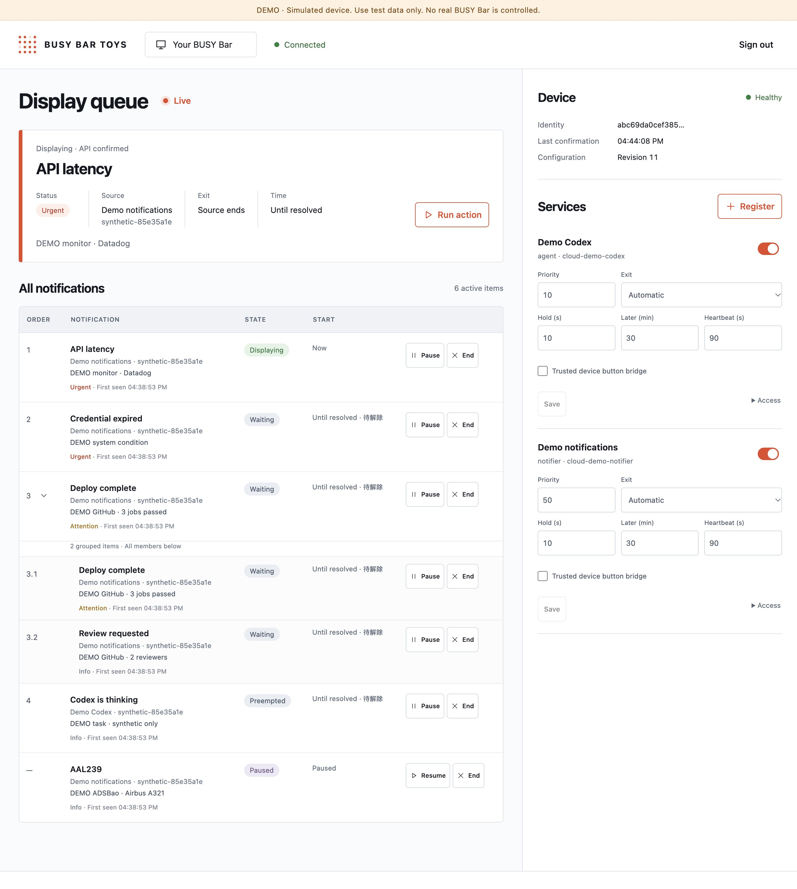

# BUSY Bar control plane

[English](README.md) · [协议](PROTOCOL.md) · [已确认的设计](../docs/plans/control-plane-v5.md)

在浏览器中管理 BUSY Bar。注册显示服务，调整优先级、退出规则和开关。查看当前控制者，以及每一条等待显示的通知。页面通过 SSE 接收完整状态。

Cloudflare 后端负责调度和写屏。Mac 负责采集 Codex、Your dot 与通知，向后端发送完整画面。关闭浏览器后，云端仍可继续调度。

**真实 Bar 和原有后台服务尚未迁移。** 本地演示与云端预览使用模拟 BUSY API，不能控制真实设备。生产部署仍待完成。



## 打开云端预览

打开[预览页面](https://busy-bar-control-plane-preview.orriduck.workers.dev)，输入 `demo-token`。这是共享的公开演示，仅使用模拟数据。请勿接入真实 Mac 采集器或来源凭据。公开演示的凭据弹窗不显示真实采集器接入命令。

预览使用独立的 SQLite namespace 和新生成的 secret bindings。模拟 BUSY Worker 没有公开路由，也不会对外发送请求。生产配置不包含模拟 upstream binding。

## 启动本地演示

使用 Node 26 和 npm。从仓库根目录运行：

```sh
cd control-plane
npm ci
npm run dev:demo
```

1. 打开 `http://localhost:8787`。
2. 在设备 token 栏输入 `demo-token`。
3. 选择 **Register**。
4. 选择 Agent checker、Notifier 或 Custom publisher。
5. 保存发布凭证。页面只显示一次。
6. 在本地运行凭证窗口中的接入命令。
7. 打开第二个管理页面，检查 SSE 更新。

页面始终标注 **DEMO**，`/api/mode` 返回 `demo:true`。模拟 API 使用 8790 端口。诊断状态位于 `http://localhost:8790/__demo/state`。

使用 `demo-blocked` 或 `demo-offline` 可以模拟设备拒绝显示或离线。它们对应同一台模拟设备。模拟 API 拒绝真实设备 token，也不会向 BUSY 转发请求。

终止终端进程即可停止本地服务器。状态保留在已忽略的 `.wrangler/` 目录。本地调度随进程停止；部署后的云端调度由 Durable Object Alarm 驱动。

## 接入本地采集器

参见[本地客户端指南](../docs/cloud-mode.zh-CN.md)。Agent 和 notifier 各注册一个服务，分别保存发布凭证。Agent 优先级应低于 notifier；页面默认分别为 10 和 50。

Setup 只保存连接信息，不替换正在运行的独立观察服务。准备好切换时，再显式选择 cloud 模式。本机不需要 Claude hooks。

自定义发布服务按 [PROTOCOL.md](PROTOCOL.md) 接入。注册服务不会让 Cloudflare 执行上传的任意代码。

## 使用管理页

- **Services：** 修改开关、优先级、退出方式、可见时长、常驻条件延后时间和心跳超时。选择 Save changes。旧版本修改会被拒绝；重新加载表单后再保存。
- **Display queue：** 查看逐条事件。展开同组项，查看所有成员。暂停、恢复或结束一条通知。
- **当前控制者：** 区分已选中、正在下发、API 已确认、被阻挡和离线。API 成功不等于实体像素回读成功。
- **Actions：** 只执行来源声明的动作。动作由原 Mac 执行。失败或未知结果不会结束通知。
- **Trusted device button bridge：** 只授权给受信任的本地按键监听器。它允许设备级 Start/Pause 操作。普通发布服务不能清除其它服务。
- **Access：** 替换或撤销发布凭证。替换会结束该服务旧凭证下的项目；本地更新凭证后才能继续发布。

紧急组按首次识别时间排队，不互相抢占。正常等待另一紧急组解除时，不弹系统通知。若显示证明过期或设备故障，Mac 的独立 watchdog 仍可兜底提醒。

有限时长从入场结束后计起，抢占会暂停计时。非紧急常驻条件显示后可以延后再出现，但来源必须仍确认条件有效。默认显示十秒，延后三十分钟。手动清除后，同一 occurrence 不会自动复活。

当前紧急项有 primary 动作时，Start/Pause 执行该动作。否则清除全部非紧急项并请求回日历；紧急项不受这次清除影响。

## 运行检查

```sh
npm test
npm run typecheck
npm run build
npm run dry-run
```

测试使用真实 Workers 运行时、SQLite Durable Object 和模拟上游 HTTP。覆盖调度、权限、持久状态和下发行为。类型检查包含前端。Dry run 只打包，不部署。

在仓库根目录运行 Python 测试：

```sh
.venv/bin/python scripts/run-tests.py
```

本地测试不证明实体动效、固件画面、生产可用性或双 Mac 迁移。已确认命令的对象回收恢复有直接测试。未确认命令通过持久 SQLite 状态重新构造对象测试；完整进程突然崩溃仍需单独验收。

## 为之后部署做准备

生产配置不含模拟上游绑定，固定调用 BUSY cloud API。不要部署 demo 配置，也不要把公开测试密钥复制到生产。

1. 将 `PUBLIC_ORIGIN` 设置为管理站点的准确 HTTPS origin。
2. 用 Wrangler secret binding 设置新的 64 位十六进制 `TOKEN_ENCRYPTION_KEY`。
3. 单独设置随机 `SESSION_SIGNING_KEY`。
4. 运行 `npm run types`，再运行上面的检查。
5. 将评审通过的生产配置部署到指定账号。
6. 先验证鉴权和云端调度，再迁移设备。

`wrangler secret put NAME` 从标准输入读取值，并会创建部署版本。密钥不能进入命令参数、Git 或日志。

设备迁移前，先准备好两台 Mac。给后端新建设备级 cloud token。将本地直连写屏服务改为独立发布凭证，再撤销旧直连 cloud token，并验证旧凭证失败。只删 Keychain 条目不等于撤销。撤销 cloud token 不影响 USB 或本地 Wi-Fi 访问。

目前只部署了隔离的预览。生产部署、设备 token 轮换与 Mac 迁移仍是独立的发布步骤。

## 存储与故障规则

后端从 BUSY status 验证设备身份，用 AES-GCM 加密保存设备 token。浏览器使用 Secure、HttpOnly、SameSite 会话 cookie。发布凭证只显示一次，只保存哈希，权限限定一个服务。初始 epoch 有效三十天，应在到期前替换。

SQLite 先保存队列和命令意图，再调用设备。每台设备只有一个顺序 dispatcher，每次写入前检查 generation。Alarm 处理过期、重试和续期。重启不能重复已确认的短时文字更新。

活动和排队中的正文按必要生命周期保存，结束、清除和过期后受限清理。审计只存 ID、时间和状态，不存通知正文。来源账号凭据留在 Mac。

后端只允许固定的方法、路径、参数和素材名，不提供任意代理。被盗的 BUSY token 仍可绕过后端；上游凭证的权限不会因此缩小。

每台设备的上限：

| 资源 | 上限 |
| --- | --- |
| 注册服务 | 32 |
| 活动项目 / 画面 JSON | 256 / 2 MiB |
| 活动项与防重放保留位 | 4096 |
| 动作 / 按键 ID / 会话 / SSE 客户端 | 512 / 2048 / 64 / 16 |
| 云端素材 | 64 文件 / 4 MiB；单个 256 KiB |
| 设备素材 | 16 个固定文件名 / 2 MiB |
| 原生文字 TTL | 最多六十秒 |

设备槽位初始化后保留扩展名。播放和待执行命令引用的槽位不能覆盖。容量不足时明确报错，不会覆盖正在播放的素材来腾空间。

云端故障时，Mac 不会自动恢复直连抢屏。原生控件超时后回日历。原 Mac 在系统允许时发紧急通知；休眠或无通知权限时无法保证提醒。

[协议细节](PROTOCOL.md) · [本地验证记录](../docs/plans/control-plane-ui-verification.md)
