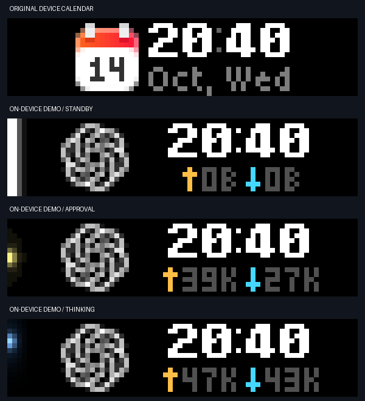

# Start/Pause, native calendar and standby — 2026-10-14

Requested behavior: Start/Pause restores the original device calendar, keeping it there until the next task turn. While in Codex mode: thinking is blue vertical motion, approval/input waiting is a stationary yellow glow, and standby is a full-height white light. Completion/interruption enter standby. Unknown/error stay gray/red rather than being mislabeled idle.

Implementation:

- A local WebSocket listener uses the official `busylib==2.6.0` generated protobuf schema and the firmware's `/api/status/ws` stream. Only START PRESS dismisses; release, OK, Back and unrelated states do not. Input zero-valued enum fields are decoded correctly. Press consumption is synchronized to avoid losing an event between poll and reset.
- A private atomic view file persists calendar mode and every observed turn identity, including stale turns. Only a newly active turn resumes drawing. Old stale turns becoming active again cannot seize the screen. The listener remains active in calendar mode.
- Local connections retry with bounded backoff; rejected local authentication stops retries. Stop cancels the listener and releases its socket. Status exposes a separate `button_input.connected` flag, with stale/unwritable diagnostics treated conservatively.
- Firmware 1.2.4's DELETE handler shadows its JSON application-name variable. Cleanup now uses the supported query scope `DELETE /display/draw?application_name=ai-status` with no JSON body, so it cannot accidentally clear another app due to that parser bug.
- Static lights retain their brightest core in the transmitted palette; the waiting glow is visibly yellow and standby spans every physical row in white.

Validation completed:

- 80 local tests passed, including actual loopback WebSocket handshake/START filtering/shutdown, concurrent press consumption, diagnostic-write failures, persistent dismissal, stale heartbeat suppression, new-turn resume and observer integration.
- Device rendering verified the white full-height standby and yellow approval glow. Native blue motion remains the existing verified animation. Clearing only this app restored the original firmware calendar, captured below.
- Visual inspection confirmed all three lights and readable clock/network values. The state cards are explicitly labeled on-device demos; they do not represent the current task lifecycle.

**Acceptance still pending: physical Start/Pause on this device.** At the initial check, USB and direct local Wi-Fi HTTP were unreachable, and a cloud stream-ticket exchange using the existing BAR token returned 401. Cloud drawing works independently of the local input connection.

The user subsequently selected Wi-Fi. The observer now supports a private `input.json` with the device's actual local address and a dedicated `app.busybar.local-input` Keychain credential. `input-wifi` obtains that address from the bound device's cloud API and provisions/reuses its local access token; it preserves the existing device access mode and password. Status reports the selected transport separately from actual stream connectivity. Authentication failures stop retries; connection failures use bounded backoff. DHCP address changes require re-running setup and reinstalling the observer.

The Wi-Fi investigation discovered the exact device through the official SDK's mDNS discovery. Its advertised address matched the live cloud Wi-Fi status, but direct TCP/HTTP timed out and Chrome reported `ERR_ADDRESS_UNREACHABLE`. This does not establish the cause; client isolation, routing, or another local network condition still needs investigation. No Wi-Fi password, access mode, router settings, macOS permissions or account settings were changed.

The service was configured for Wi-Fi, with its dedicated local access token stored and read back successfully from Keychain. The private configuration contains only `addr` and has mode 0600. At that check, cloud drawing worked, but `button_input.connected=false` / `error=unavailable` confirmed that local input remained unavailable.

**Latest check, 2026-10-14:** the user confirmed that the Mac uses 5 GHz and the Bar uses 2.4 GHz. Direct local TCP subsequently succeeded. The running observer now reports `button_input.connected=true`, an empty error, and `button_input.transport=wifi`. This flag requires a valid decoded device stream; a saved address alone cannot set it. No router or Wi-Fi settings were changed. The differing radio bands are not preventing this observed connection. Physical Start/Pause acceptance remains pending because the user is not available to press it now.

[Ten-second automatic return to the native calendar](standby-timeout.md) has passed separate actual-device acceptance and does not depend on the local button stream.

Official sources checked 2026-10-14:

- [SDK local-only stream and input decoding](https://github.com/busy-app/busylib-py/blob/main/src/busylib/client/state_stream.py)
- [Input protobuf enums](https://github.com/busy-app/busybar-protobuf/blob/dev/input.proto)
- [Firmware canvas input behavior](https://github.com/busy-app/busybar-firmware/blob/1.2.4/applications/services/canvas/canvas.c)
- [Firmware DELETE namespace parser](https://github.com/busy-app/busybar-firmware/blob/1.2.4/applications/services/web_server/http_api/api_display.c)
