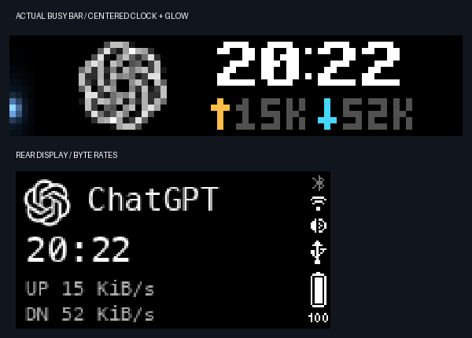

# Centered clock and vertical glow — 2026-10-14

Follow-up: [button/calendar and standby](button-calendar.md) changes approval to yellow and standby to a full-height white light.

User direction: follow the calendar's centered layout, compact the traffic display, use different arrow colors, and move the state bar to the far-left columns with vertical motion and light falloff.

The icon is centered vertically at 14×14. The 57-pixel icon/text group is centered in the space after the four-column light and a three-column gutter. Its 40-pixel text panel centers the original BUSY clock and the compact network line independently. Upload is amber `#FFBE45`, download cyan `#45D7FF`; numerals stay gray. The group dimensions remain fixed as the rates change. There is no bottom horizontal strip or textual task state.

The 4×16 light has a bright core and a dimmer, wider halo with smooth brightness changes between physical rows. Its center travels y=1→14→1 in 92 frames at 30fps. The new `thinking-v3.anim` native asset avoids reusing cached 52×1 dimensions; the 18,089-byte file retains firmware 1.2.4's bicycle0/BGR format. Working frames run on the device. Waiting and other states use stationary state-colored light; idle is dim. Existing five-second clock/network updates, display expiry, priority and scoped cleanup remain unchanged.

The clock/icon bitmap reserves a grayscale palette plus the exact two arrow colors. This prevents a small arrow from being averaged into the much larger grayscale icon by the 16-color XPM quantizer. The dedicated light widget owns the full four-column area, and the bitmap beneath it stays black.

Validation:

- All 64 tests passed. Checks include 4×16 raw frame sizes, BGR ordering, monotonic out/back peak movement without jumps, brightness falloff, centered bounded content, stable icon position as rates change and preservation of exact arrow colors in the transmitted XPM.
- Twenty-three actual screen samples produced vertical peaks 8,12,12,9,5,1,5,8,12,12,9,5,2,4,8,12,12,9,5,2,4,7,11. Both vertical directions were observed across repeated clock/network refreshes.
- Actual device pixels retained both exact arrow colors. Visual inspection confirmed the centered icon/time/network group, readable gray rates and visible left light halo without overlapping content.
- WAIT stopped the light in a warm stationary glow. Returning to the real working task restored native motion; clock and arrows remained visible throughout.

The preceding [network verification](clock-and-network.md) documents the real counter source, units, unknown values and native clock font attribution.
