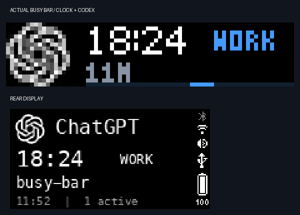

# Clock and thinking animation — 2026-10-14

Historical first clock layout. The subsequent [clock/network update](clock-and-network.md) replaces elapsed/state labels with network speeds and the original BUSY clock font.

User request: move the thinking animation back and forth and keep the wall clock visible while monitoring Codex.

Front layout: source icon at x=0, fixed white HH:MM at x=20, colored task state at x=52, elapsed minutes/concurrent count below, a 52×1 animation strip at y=15. Back layout: source, current time, state, project and elapsed time. Clock uses America/New_York in 24-hour form, including daylight saving time. Status changes do not hide or recolor it.

The thinking strip travels 46 pixels out and back over 92 frames at 30 fps (about 3.1 seconds). It runs on the BUSY Bar itself. The Mac continues to refresh state/time and the 15-second display lease every five seconds. Repeated requests keep the same animation path and await the previous range boundary. Firmware 1.2.4 cannot change a widget type in place: animation/static transitions first clear the helper’s own `ai-status` namespace, then redraw all its elements. Same-type refreshes keep playback intact.

Native file format is deliberately matched to the verified firmware 1.2.4: `bicycle0`, a 36-byte header, one 21-byte default section, and 92 uncompressed BGR888 frames. The development branch's newer `bicycle1` format is not accepted by that firmware. The 14,777-byte asset is generated locally and uploaded once per observer process to `ai-status/thinking-v2.anim`.

Sources checked 2026-10-14:

- [Firmware 1.2.4 reference encoder](https://github.com/busy-app/busybar-firmware/blob/1.2.4/scripts/seq2anim.py)
- [Firmware 1.2.4 player](https://github.com/busy-app/busybar-firmware/blob/1.2.4/applications/services/gui/modules/anim_player.c)
- [HTTP API 1.2.4](https://api.busy.app/busybar/openapi.yaml?Name=1.2.4)

Validation: 55 local tests passed, including clock summer/winter offsets, unchanged clock across task states, continuous out-and-back motion, native frame offsets and BGR byte ordering, binary asset upload and namespace boundaries. The device's actual front screen was sampled 24 times over 9.58 seconds. Marker positions were 31,42,41,32,23,12,2,15,24,33,46,36,24,15,6,3,14,24,34,45,37,25,16,7, proving movement in both directions across five-second screen refreshes. After correcting firmware widget-type transitions, a fresh WORK → WAIT → WORK device check confirmed an amber static strip while waiting and restored native blue motion afterward. A further 22 actual frames showed marker positions 26,38,40,28,18,7,6,19,31,41,39,26,13,0,12,26,39,40,26,13,2,14. Visual inspection confirmed the current clock and WORK label fit both screens; the screenshot below is from the running observer after recovery.

