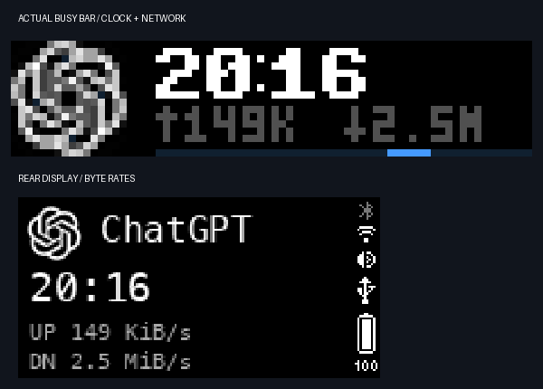

# Native clock and real network rates — 2026-10-14

The user requested the attached BUSY clock style, approved the existing source icons, replaced gray text with upload/download speed and removed WORK/WAIT labels.

The front uses the unmodified BUSY Bold 7 pixel font from firmware 1.2.4, matching the built-in clock's font choice. Its 6×7 glyphs are rendered at their native TTF size, with HH:MM at x=20/y=1. A gray speed row at y=9 displays upload then download using arrows. Native 30fps motion continues on y=15. Task states affect only the strip, with no state words on either display. Idle continues to refresh clock and speed without inventing a running task. The back shows the source, time and explicit UP/DN byte rates. Finite demos retain a DEMO header.

Rates come from this Mac's default routed interface using local `/sbin/route` and `/usr/sbin/netstat` counters. They are observed traffic, not bandwidth capacity, a speed test or the BUSY Bar's own traffic. Only Link rows count; IP rows duplicate totals. Delta bytes are divided by monotonic elapsed time every five seconds, with a new baseline after errors, interface changes, resets or nonpositive intervals. Unknown rates display `--`. Compact B/K/M/G map to B/s, KiB/s, MiB/s and GiB/s; the back spells out units. Commands are bounded by two-second timeouts and never retained in logs.

Validation:

- 64 local tests passed, covering upload/download direction, monotonic deltas, duplicate IP rows, tunnel rows, reset/interface/error recovery, compact unit boundaries, gray rates and label removal, idle observer updates and the existing lifecycle/API/native animation behavior.
- Passive sampling returned real nonnegative `en0` upload/download rates. Actual screens displayed UP 149 KiB/s and DN 2.5 MiB/s in the captured frame.
- Actual WAIT → WORK checks retained the white clock and gray rates while changing the strip from amber static to blue native animation. Sixteen actual marker positions were 29,41,39,26,16,5,8,21,35,45,32,18,5,8,22,34. Both directions were observed, and the gray speed row changed across two screen updates.
- Visual inspection of actual front/back frames confirmed the approved icon, native clock glyphs, complete gray speed values and no WORK/WAIT text or overlapping rows. The image below is the running observer's actual frame, not a simulated preview.

Official sources checked 2026-10-14:

- [Built-in clock font selection](https://github.com/busy-app/busybar-firmware/blob/1.2.4/applications/main/clock/widgets/clock_view.c)
- [Unmodified clock font](https://github.com/busy-app/busybar-firmware/blob/1.2.4/assets/shared/fonts/ttf/busy_bold_7px.ttf)
- [Font license declaration](https://github.com/busy-app/busybar-firmware/blob/1.2.4/LICENSE.md); OFL 1.1 and source attribution are included beside the font asset.
