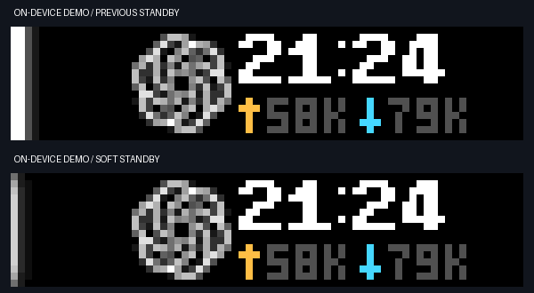

# Softer standby and a single total rate — 2026-10-14

Standby retains its full-height neutral white identity, using one bright column instead of two, a much fainter lateral halo, and dimmer ends. It remains static and returns to the native calendar after the existing ten-second timeout.

The front traffic line now contains two activity arrows followed by one total: measured upload plus download, formatted with the existing byte-rate units. A direction's arrow lights in amber/cyan only when that direction has a positive measured rate; zero and unavailable readings use dark gray. Missing measurements display `--`, not a fabricated zero. The line fits completely under the native clock. The back retains separate UP and DN readings.

All 102 tests pass. The added behavior checks verify the displayed sum, invariance when directions swap, separate back-screen detail, and inactive/unknown arrows. Actual device framebuffer inspection confirmed a slim neutral standby light, softened ends, and the centered single-rate line. The screenshots below were captured from explicitly labeled on-device DEMOs; they do not claim a real task had ended.

