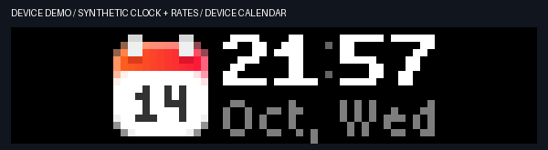

# Display motion — 2026-10-14

The motion controller uses five reusable effects.
The approved clock, icon spacing, and network layout stay the same.

| Trigger | Effect | Native playback time |
|---|---|---|
| Enter Codex mode | Fade in the front display. | 400 ms |
| Return to the calendar | Fade out, then release this app's display. | 200 ms before release |
| Change task state | Dim the light, change its color, then brighten it. | 167 ms out + 233 ms in |
| Change source | Fade out the icon, replace it, then fade it in. | 167 ms out + 233 ms in |
| Change a decimal digit | Roll with subpixel coverage and damped settling. | 400 ms |
| Change a rate unit or field format | Fade out the rate field, replace it, then fade it in. | 133 ms out + 200 ms in |

These times describe stored frames at 30 fps.
Cloud requests add transport time between the dim and reveal steps.
The controller counts the outgoing fade from request dispatch.
It does not add the complete response delay to that fade again.

Only changed regions animate.
The clock remains visible during light, source, and rate-format changes.
Only changed decimal digits roll.
Repeated refreshes do not replay the same transition.
The thinking light keeps its vertical movement between refreshes.

The observer keeps reading task and button events between transition steps.
A newer state replaces a queued target.
A new turn can cancel a pending return to the calendar.
An expired display lease uses a complete entrance effect on recovery.

## Device playback

The device plays native `bicycle0` animation files.
The Mac sends target states instead of individual frames.
Fifteen assets use 356,779 bytes in total.
The largest asset uses 164,667 bytes.
An observer uploads each asset once after it starts.
Successful uploads are retained if a later upload fails.

Black BGRA masks control transparency above the existing widgets.
Separate outgoing and incoming file paths restart one-shot playback.
The light keeps its animation widget type in every state.
This avoids a clear-and-redraw gap during a color change.
Cleanup removes only the `ai-status` namespace.

## Reduce motion

Use `install --reduced-motion` for a background service with static lights.
Use `watch --reduced-motion` for the same behavior in a terminal.
This option also stops the blue light's vertical movement.
The ten-second standby rule and button handling remain active.

## Inspect the result

The following GIF contains actual device framebuffers from an 18-second demo.
The demo uses synthetic clock values and network rates.
The back display identifies it as DEMO.
Cloud capture returned 64 samples at about three samples per second.
This capture does not measure the device's playback frame rate.



The [frame contact sheet](images/actual-motion-frames.png) shows the entrance,
digit roll, color change, source change, standby, and original calendar.
Visual inspection confirmed intermediate dimming and rolling digits.
The clock stays readable while the icon and light change.

The next GIF is a software rendering of the production assets and controller.
It shows the intended frame sequence at 30 fps.
It does not include cloud delays and is not a device recording.


Create a local rendered preview:

```sh
.venv/bin/python scripts/motion-preview.py --output .local/motion-preview.gif
```

Use `--calendar PATH` to supply a raw 72 × 16 calendar capture.
Without this option, the released background is black.

For a real device demo, stop the observer, run `motion-demo --seconds 18`,
then reinstall the observer.
See the complete commands in the [README](../README.md#preview-and-capture).

Unit and observer tests cover alpha endpoints, native section offsets, digit
endpoints, interrupted transitions, target replacement, format changes,
upload recovery, expired leases, rejected draws, reduced motion, and standby timing.
All 121 local tests passed.
The [timed device check](standby-timeout.md) confirmed the calendar at 11.012 seconds
after the standby timer started, including the outgoing fade and cloud capture.

The later [weighted-motion refinement](weighted-motion.md) adds Bold7 flight
identities, damped glyph rolls, and smooth endpoint motion for the blue light.
The complete project suite now has 160 passing local tests.

## Firmware sources

Checked against firmware 1.2.4 on 2026-10-14:

- [Animation file header](https://github.com/busy-app/busybar-firmware/blob/1.2.4/lib/anim_file/anim_file_format.h).
- [Animation player](https://github.com/busy-app/busybar-firmware/blob/1.2.4/applications/services/gui/modules/anim_player.c).
- [Canvas widgets](https://github.com/busy-app/busybar-firmware/blob/1.2.4/applications/services/canvas/canvas_widgets.c).
