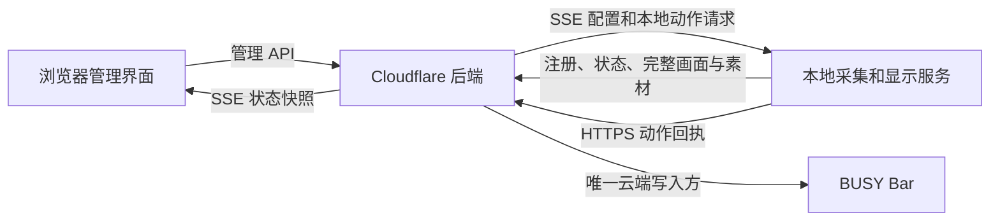

# Approved control plane design

Source: https://github.com/orriduck/busy-bar-toys/issues/10

<!-- busy-bar-control-plane-design-v5 -->
## 当前有效设计：v5（2026-10-15）

已根据 [Claude 的七项评审](https://github.com/orriduck/busy-bar-toys/issues/10#issuecomment-6199275291) 及其[认可 v2 后的两项补充](https://github.com/orriduck/busy-bar-toys/issues/10#issuecomment-6199724041) 修订。**这是设计与验收规则的更新，尚未实现、部署、轮换 token 或迁移设备。**

研究基线：`main@93e0688867f4fde73a5f6eeeb18dab649a32e4b7`。以下 v5 为当前评审对象；末尾保留的 v1 仅供对照，冲突处以 v5 为准。

### 评审结论：v5 已达成设计共识

Claude [明确确认 v5，无剩余设计遗漏](https://github.com/orriduck/busy-bar-toys/issues/10#issuecomment-6200049641)，与 Codex 的 [v5 修订回复](https://github.com/orriduck/busy-bar-toys/issues/10#issuecomment-6200027320) 对齐。**当前共识基线为 v5，验收清单仍待实现和测试。**

评审过程：v3 曾获认可，后新增紧急 FIFO、正常排队不通知和事件队列，形成 v4；v4 认可后补齐按键清除、常驻稍后再显示和同组折叠，形成 v5。v3 的“排队紧急项也通知”已被替代，不适用于当前设计。

### 已确认的产品边界

- Cloudflare 部署浏览器管理界面与后端；浏览器关闭后后端持续调度。
- 浏览器与本地显示服务都和后端通信，只有后端调用 BUSY API 写屏。
- 本地复用采集器、Pillow 字形、MotionDirector 和 NotificationPresenter，生成显示所需状态与素材。
- 可注册服务，调整优先级、退出规则与开关。显示当前控制者、逐条事件队列和来源实例。
- 首版通过 SSE 同步当前状态全量快照。历史事件补齐与实际设备画面预览延后。

### 后端、调度与显示协议

- Workers + Static Assets 承载管理界面与 API；每台验证身份的 Bar 对应一个 SQLite-backed Durable Object。所有生产者通过认证 API 接入，DO 是后端内部组件。
- 后端验证设备级 BUSY cloud token 并读取真实设备身份。设备 token 加密保管；Worker secret binding 提供加密密钥。浏览器使用 HttpOnly/Secure/SameSite 会话；每个服务使用独立、可撤销的发布凭证。
- 服务配置包含 enabled、priority、退出规则、常驻状态稍后再显示间隔与心跳超时。紧急项优先于非紧急项；紧急项之间遵循第 9 节的首次识别 FIFO，不因服务 priority 不同而互相抢占。非紧急项按配置优先级选择，同级保留当前者，等待项先到先服务。
- 固定时长从设备接受显示且入场结束后计起；抢占暂停有效显示时间，恢复后继续剩余时间。重复心跳不重置时长，也不复活已结束的 presentation。
- Codex 运行期间持续显示、待机十秒回日历；飞机入场后显示十秒。源主动结束、禁用、超时或失联后，重新选择最新有效 presentation。
- 注册协议发布完整 presentation 和内容哈希素材；单个 renderer 的最后一条增量 draw 不能冒充完整恢复场景。恢复时重新入场，使用最新状态。
- 每台设备只有一个有序 dispatcher。先持久化 desired revision/generation/命令状态，再调用外部 API；每次后续 mutation 前检查 generation。实际 owner 只在设备响应后确认，页面区分 selected/applying/displaying/blocked。
- 已发出的设备 HTTP 请求不能由 generation 撤销。限制超时，并在同一设备的顺序队列中处理后续纠正写入；旧 producer 无权清除或续期新 owner 的画面。
- 服务排序与固件 draw priority 分开。409 等设备拒绝显示为 blocked，不报告成功。
- Alarm 处理最近的退出、过期、刷新或重试；处理器幂等并能从持久状态恢复。断网时本地不会自动改回直连写屏。
- Start/Pause 由现有受信任 Wi-Fi/USB 输入监听上报，并按事件 ID、设备和 generation 去重。非紧急项保留回日历直到新一轮任务的规则；紧急项按下述动作协议执行；事件队列清除、稍后再显示与同组折叠见第 10 节。

### 已认可的 v2 处理决定

| 评审项 | v2 处理 |
|---|---|
| 1 动作执行 | 补完整的本地动作请求、去重、回执、失败与未知结果协议，列为首版阻塞项。 |
| 2 旧客户端写屏 | 迁移时新建云 token 并撤销旧直连云 token，明确 Wi-Fi/USB 不在这项撤销的覆盖范围内。 |
| 3 token 权限 | 后端精确方法/路径/参数白名单，明确上游 token 被盗后仍可绕过 Worker。 |
| 4 云故障紧急提醒 | 采用 (a) Mac 系统通知兜底；继续保持后端统一写屏。 |
| 5 文字续期 | 前移到首版；分离心跳、普通控件续期和文字内容更新。 |
| 6 素材增长 | 前移到首版；全设备槽位与字节配额、播放中保护、云缓存清理。 |
| 7 首版范围 | 延后预览与历史补齐；保留通用注册、两个默认接入模板和基本配置 revision。 |

## 1. 本地动作与回执

代码核对：Datadog 的 `primary` 是本地函数，经 `pup` CLI 执行 acknowledge。
现有 `_primary` 和 `action_results` 在 Mac 内传递结果。后端不能直接执行这些
闭包，也不应取得 Datadog 等来源的本地账号凭据。

修订协议：

1. 注册时声明支持的 `action_key`；具体处理器由本地安装的代码提供。
2. 按键或浏览器动作请求携带当前 presentation 标识和 generation，后端先检查
   当前控制者，再生成 action 记录。
3. action 绑定 device、service、producer instance、item ID、generation、
   action ID 和有效期。通过该实例的 SSE 下发动作 ID、白名单 action key 和
   必要业务 ID，不下发任意 shell 命令。
4. Mac 持久化去重记录，执行后用 HTTPS 上报结果。结果重发可幂等，但不代表
   外部副作用可以自动重复执行。
5. 状态至少有 pending、running、succeeded、failed、unknown。执行方离线时
   显示不可用；结果超时或执行中崩溃时显示 unknown，保留通知。
6. 只有成功结果作用于原 item。迟到回执不能清掉新 generation 的画面。
   已发起的动作不会因为画面切换就能被撤销。

不能保证网络分区和 Mac 崩溃下的外部动作“恰好执行一次”。来源 API 支持
幂等键或可查询状态时才能安全重试；否则未知结果需要查询或人工重试。

## 2. 单写入方迁移

迁移验收清单如下；本 issue 尚未授权或执行实际 token 撤销：

1. 先完成后端、两台 Mac 的 cloud adapter 和有限模拟测试。
2. 为该 Bar 创建新的设备级云 token，只在后端加密保管；验证设备身份与连通性。
3. 暂停两台 Mac 上旧的直连服务，将它们改为独立服务发布凭证。
4. 撤销该 Bar 所有仍授权旧直连写入方的云 token，而非只删除 Keychain 条目。
   验证旧云凭据得到认证失败，后端新凭据仍可用。
5. 启动 cloud 模式并核对两台 Mac 只调用 control plane，后端是唯一云写入方。
6. 做旧客户端重启、云端断线、抢占和清理测试，确认旧云 token 不能恢复写入。

官方提供创建与删除 token；“轮换”在此指新建并撤销旧凭据，不假设存在原地
rotate API。已保存的闲置 Keychain 条目本身不会写屏，上游撤销才使凭据失效。

现有测试验证了 observer 遇到资产上传认证失败会停止且不重试。
这不代表所有未知旧版本都遵循同样逻辑；旧云凭据失效才是边界。

另一个限制：云 token 的撤销不撤销 Wi-Fi 密码，也不改变 USB 的访问方式。
目前按键监听仍使用受信任的本地通道。因此这里保证的是统一的云端写入架构，
不能宣称对任何拥有本地设备访问权的程序都实现了固件级写入隔离。
Claude 报告的另一台 Mac 当天叠画问题属于评审者的实测描述，本次未独立复验。

## 3. 设备 API 最小调用面

后端不提供任意 BUSY URL/path 的透明代理。请求必须命中明确的方法与路径：

- `GET /status`、必要的状态子路径和 `/version`。
- `POST /display/draw`。
- `DELETE /display/draw`，强制限定平台命名空间。
- `POST /assets/upload`，强制限定平台目录、合法槽位、类型和大小。
- `GET /screen` 可预留给后续预览，并限制 display 参数。

所有未列入的路径、方法和参数均拒绝。禁止重定向、外部目标、跨命名空间
清除和任意设备存储路径。网络、账号连接、MQTT、固件等设置不在调用面内。
设备 token 仅在专用 BUSY API 客户端执行许可请求时解密；任何注册服务都不能
直接取得它。测试应覆盖方法混淆、路径编码、参数越界及清理范围。

官方文档确认 HTTP API 覆盖网络、账号和系统设置等广泛能力。
“可修改 MQTT 配置”的特定实测由 Claude 报告；本次没有对设备做这类操作。

重要限制：Worker 白名单约束后端接口的能力。若真实 BUSY token 被盗，攻击者
可以绕过 Worker 直接访问 BUSY API。加密、最小解密路径、密钥管理和撤销流程
会降低风险，但不会把上游广权限 token 变成真正的显示专用 token。

## 4. 紧急项显示失败的兜底与正常排队豁免

采用 (a)：原 producer Mac 发系统通知兜底，继续保持后端统一写屏。
正常等待另一紧急项解除不算故障；Bar 不能显示（blocked/offline/未确认）才兜底。

- 本地首次识别紧急 item 时建立独立 watchdog，默认 N=10 秒，可配置。
  N 秒内既没有本项有效显示确认，也没有以下有效的正常排队证明，则发系统通知。
  明确的 blocked/offline/失败可以提前触发。
- 本项显示确认绑定 device/service/item/instance/generation，以当前 generation
  的 BUSY 绘制 API 成功响应为依据，并有有限的 confirmed-valid-until。
  注册、发布成功、被选中都不是显示确认；API 成功也不是物理像素回读证明。
- 正常排队证明必须同时满足：当前完整快照确认本项仍在紧急队列；它正在等
  另一紧急项；该当前控制者有匹配 generation 且未过期的设备显示确认；设备
  无已知 blocked/offline/失败。证明绑定队列 revision、本项身份和当前控制者，
  有效期不能超过该控制者显示确认的有效期。仅有“已入队”不能豁免。
- 有效正常排队期间不发系统通知，无论等待多久；管理页仍列出该项。
  前项解除后按 FIFO 入场，此时必须取得本项显示确认，不能继续借用前项证明。
- 正常排队证明到期、前项退出或本项显示确认到期后，从失效时刻起最多 N 秒
  内重新取得有效显示/正常排队证明，否则兜底。N 内收到明确失败则提前触发。
  新 SSE 心跳、重复快照、重连和 producer 心跳都不能推迟既有失败截止时间，
  也不能凭空延长设备确认；新设备确认才可建立新的有效证明。
- watchdog、截止时间和去重由原 Mac 保持，使用本地单调计时。
  SSE/后端断开后，最近的有限证明最多存活到原有效期；届满后照常计时兜底。
  本地重启不能重置已过期截止时间；缺少可靠恢复状态时按未确认处理。
  迟到旧 item/generation/revision 不能恢复排队豁免或取消当前计时。
- 同一紧急 item 的系统通知合并去重，不因重复心跳反复弹窗；恢复后仍使用
  稳定 item 身份，直到来源解除。用户明确暂停/禁用的项不因其不显示而兜底。

系统通知失败或缺少权限应可诊断；Mac 休眠时不能保证提醒。
不采用设备直连回退：后端专用云 token 不重新交给 Mac。
后端停止续期后 Bar 回原生日历。这个故障边界写入用户文档。

## 5. 有限时长文字与长期显示续期

已核对的 API 27.5.0 允许文字 timeout，但未发现独立更新现有文字 TTL 的接口。
现有独立模式使用 60 秒文字 timeout、约 45 秒更新；以下是待实施的云模式规则。

- 默认十秒等有限 presentation，一次设置足够覆盖“文字出现到本次显示结束”
  的 timeout，余量包含剩余入场时长与网络/清理误差。显示期间不重复发送同内容文字。
- 恢复被抢占的有限项时，按新的剩余可见时间和入场时长重新生成 timeout；
  不能直接沿用原始完整时长，也不能复活已结束项。
- 采用有上限的设备文字 TTL，避免云故障后长时间残留。初始安全上限 60 秒。
  短时项 timeout 取剩余时长、入场与余量之和，并受该上限约束。
- 直到解除才退出的紧急项需要长期续期；自定义固定时长超过安全 TTL 的项
  同样需要受限续期。不能假设所有非紧急项都固定为十秒。
- 普通 heartbeat 不重发文字；长期项只在接近文字过期时更新，允许这一次
  更新重启滚动。内容变化和新的完整入场也可重发对应文字。
- 非文字控件的必要续期与文字独立。每次更新保留原生动效播放状态。
- 临近过期重发的已知滚动边界、短时项完全不重发文字、抢占后剩余时长和
  大小字入场时机都纳入验收。

## 6. 素材容量

云端可以继续使用内容哈希。设备端使用固定名字的全局槽池，另设固定公共
动效资源和总字节上限；具体数量在验证素材容量后配置。

不能只限制每个服务两个槽：服务注册数增加时，总文件数仍会无界增长。
后端保存 hash → 槽位/版本映射；当前播放、排队中的设备命令所引用的槽位
不能覆盖。容量不足时拒绝或等待，不能覆盖正在使用的文件。

抢占恢复时，从受限云缓存重新装载所需素材。云缓存同样需要配额和清理，
不能把设备有限槽位变成云端无限堆积。

## 7. 首版范围

保留：

- 设备登录与后端凭据保管。
- 通用服务注册、独立发布凭证、开关、优先级与退出规则。
- 两类默认接入模板：agent checker 与 notifier；无需增加任意云代码执行能力。
- 当前已确认控制者、待切换目标，以及第 9 节逐条事件队列（不仅是服务列表）。
- SSE 全量快照：首次连接、状态变化和断线重连均发送当前完整状态。
- 简单配置 revision 检查：基于旧 revision 的修改返回冲突并重新加载。
- 本地动作回执、紧急项系统通知兜底，以及文字和素材正确性要求。

延后：

- `Last-Event-ID` 历史事件补齐；首版重连直接收全量快照即可。
- 前后屏截图预览。
- 复杂的多页面冲突合并、统计分析和服务执行托管。

保留基本配置 revision 的成本较小，也能避免两个页面静默覆盖设置。
通用服务注册保留，满足用户明确提出的需求；默认模板先提供两类，服务身份与列表保持可扩展。

## 8. 云端文字与事件记录

审计事件只保存服务/item/action ID、状态、revision 和必要时间，不记录 PR
标题、监控名或原始画面正文。日志有保留期限，不打印敏感响应。

活动与排队中的 presentation 都需要在云端保存标题、详情和必要素材，支持
管理页队列和恢复。被抢占、已暂停或稍后再显示但仍可恢复的项也属于未结束项。
正文保留到显示结束、来源解除、取消、过期或移除；有界恢复窗口结束后清理。
若“直到解除”项来源一直有效，其正文可持续存在，不能承诺十秒后删除。
对项目数、正文/素材字节数、失联过期与恢复窗口分别设上限，满额拒绝并明确
报错，不能静默丢弃队列；服务增多不能令储存无界增长。

当前管理 SSE 全量快照包含这些未结束项的标题和详情；历史审计不含正文，
也不为延后的历史 SSE 补齐预存正文。设备管理员可看完整队列；producer
只收自己授权服务的正文、动作与队列状态，以及必要的设备健康/当前紧急控制者
确认元数据，不取得其他服务标题/详情。健康证明不要求泄露前项正文。

## 9. 紧急 FIFO 与管理页事件队列

### 调度与稳定身份

- 每条 presentation 是一条队列记录，键绑定 device、service、producer instance
  和稳定 item ID。一个服务可同时有多条通知，不能被“服务最后一条状态”覆盖。
- 每项保存不可变的首次识别时间、后端首次接收时间与持久化入队序号。
  紧急项按首次识别时间先到先显示，同时间以入队序号裁决，不互相抢占。
  新到但声称更早的项也不能中断正在显示的紧急项；只影响等待项排序。
- producer 上报 UTC 首次识别时间并在重复发布/重连时保持；后端检查合理范围。
  缺失或明显时钟偏差时用首次接收时间排序并显示时间不可靠标记，不允许
  任意回填历史时间插队。容许偏差作为协议配置，验收覆盖跨 Mac 时钟偏差。
- 重复心跳、内容更新、DO 重启、网络重连和服务 priority 修改不改变既有
  item 的首次识别时间/入队序号，不创建重复项。真正解除后再次发生用新 item。
- 当前紧急项解除、成功动作确认结束或按既有过期/禁用规则退出后，下一个
  有效紧急项入场。暂停项不参与调度；暂停/恢复保留原身份与识别时间，
  也不能抢占当前紧急项。普通有限项继续按既定剩余可见时间恢复。

### 管理页与 SSE

队列逐条显示：顺序、级别、服务和来源实例、标题、详情、首次识别时间、
状态（显示中/等待/被抢占/已暂停/稍后再显示），以及预计开始时间。另保留 selected、
applying、blocked 与设备健康，不能把选中或提交画面标为已显示。
暂停项在队列区可见，但标记不参与当前顺序；不可伪造其预计开始时间。

有限前项按剩余可见时间、必要入场与前序已知等待估算，明确标注“预计”，
每次队列 revision 更新重算。前面有直到解除的紧急项则显示“待解除”；
暂停、失联或执行结果未知且不可推算时显示对应原因，不给出虚假时刻。
新事件和抢占可能改变预计时间。

SSE 首次连接、变化、重连发送同 revision 的完整事件队列、当前控制者、
设备健康和配置状态。生产者连接按权限裁剪；页面据全量快照替换列表，
不会把旧增量拼成重复项。已结束、取消、已清除、过期项退出当前队列并按第 8 节清理。

## 10. 既有通知行为映射

### Start/Pause 清除与紧急动作

- 沿用现有按键分支：当前紧急项有 primary 时，Start/Pause 发起第 1 节本地
  主动作；失败/未知不结束通知，成功仅作用于原目标，不顺便清除其他紧急项。
- 进入“清非紧急项并回日历”的分支时，对该设备当前 revision 中显示、等待、
  被抢占、暂停、稍后再显示的全部非紧急 item 原子标记为“已清除”，退出队列。
  紧急项不受此清除影响；仍有有效紧急项时继续显示它，不能宣称强制回日历。
- 后端保存有界的已清除 tombstone，向相应 producer 返回 item 级结果，管理页
  SSE 立即更新；迟到上传/心跳不能让同一 item 重新入队。保留最小 ID/版本
  而不保留正文；以发布有效期/epoch拒绝 tombstone 清理后到达的旧事件。
- 状态通知只有来源确认解除后再次成立才生成新 occurrence/item；手动清除
  不能被三十分钟自动重现覆盖。Codex 当前已知轮次保持回日历，下一新轮再显示。
  并发新事件按后端有序 revision 定义清除边界，不能被旧按键/旧动作回执误清。

### 常驻状态稍后再显示

- 区分一次性 event 与 standing condition。非紧急常驻状态累计显示默认十秒
  后，进入“稍后再显示”，默认三十分钟，可配置。紧急项继续直到解除，除非
  有显式有限退出规则；不因十秒计时自动进入该状态。
- 稍后再显示项保留原 item/首次识别时间和重新出现时间，不占当前显示顺序；
  管理页仍可见，SSE 同步 next-eligible-at，ETA 标明“预计重新出现”。
- 到时来源仍确认条件有效、未清除/禁用/暂停且心跳未过期，按原身份重新变为
  等待项并重新开始一轮可见时间；来源解除或失联过期则移除，不能凭旧状态复活。
  到时只是重新参与调度，不保证正好在该时刻上屏。
- 重复心跳不延后重新出现时间。被抢占只暂停剩余可见时间，不启动三十分钟
  延后；DO 重启恢复持久化时间，不能重置。正文仍按第 8 节限额/失联清理。

### 同组折叠与逐项可追溯

- 保留来源提供的 group key；组命名空间限定设备与授权服务，不能用同名 key
  合并别的服务。未指定 group 的 item 单独成组；每项记录仍独立保存。
- 每组在屏幕调度中只占一个位置，取当前有效成员的最高级别作为代表；同级
  按既定稳定顺序裁决。管理页折叠成一行，展示成员数、最高级别和代表标题，
  展开可见每条成员的标题、详情、状态、首次识别时间与来源。SSE 包含成员关系，
  不能只传代表项而丢失其他事件。
- 含紧急项的组按最早有效紧急成员的首次识别时间参与紧急 FIFO；旧的普通
  成员时间不能让新紧急组插队。组更新不能抢占另一个正在显示的紧急组。
- 一次入场固定成员 ID/版本快照；非紧急事件显示结束时，这次包含的同组
  事件一起结束，常驻成员按各自规则进入稍后再显示。后到成员不能被旧显示
  完成或迟到动作回执一起清除；同组主动作仍只绑定声明的原目标。
- 当前代表项退出后重算仍有效成员与组位置；紧急条件不得因普通成员显示
  完成而被清除。已清除/过期项不参与代表选择，组为空后移除折叠行。

## 核对依据

- [Claude 原评论](https://github.com/orriduck/busy-bar-toys/issues/10#issuecomment-6199275291)
- 基线代码 `apps/src/busybar_apps/datadog/__init__.py`：本地 primary 回调与 CLI。
- 基线代码 `service/src/busybar_service/cli.py`：action_results、结果成功后才 dismiss。
- 基线代码 `service/tests/test_idle_watch.py`：认证失败停止测试。
- 基线代码 `notifier/src/busybar_notifier/{display,presenter}.py`：文字 timeout 和刷新规则。
- 已保存的 API 27.5.0 OpenAPI 定义：TextElement、设备 draw、状态与账号端点。
- [BUSY token 的创建、作用域和删除](https://docs.busy.app/bar/dev/api-tokens)
- [BUSY HTTP API 能力与 USB/Wi-Fi/互联网认证](https://docs.busy.app/bar/dev/http-api/)
- [Cloudflare Alarm 的至少一次执行语义](https://developers.cloudflare.com/durable-objects/api/alarms/)

## v5 验收清单

- [ ] 设备身份、管理会话、服务发布凭证隔离；服务无权取得设备 token 或修改其它服务。
- [ ] 浏览器关闭后继续调度；source Mac 离线与云端不可达有明确状态。
- [ ] 同级稳定、优先级抢占、可见时间暂停/恢复、心跳过期、禁用和主动结束。
- [ ] 旧 generation、迟到动作结果、重复按键/SSE 投递不会操作或清除新 owner。
- [ ] 动作成功、失败、离线、执行中崩溃和未知结果；不盲目重复外部副作用。
- [ ] 旧直连云 token 撤销后失效；新后端凭据工作；两台 Mac 不直接写屏。
- [ ] 不允许的设备路径/方法/参数、跨命名空间清理和重定向被拒绝。
- [ ] Alarm 重复执行和 DO 重启恢复；设备 HTTP 请求超时及切换顺序。
- [ ] SSE 初次/重连/变化时全量快照，慢客户端有界；未完成动作可从持久状态重新同步。
- [ ] 管理写入带配置 revision；旧版本返回冲突并重新加载，不做复杂合并。
- [ ] 小字入场时机、长文字跨普通续期继续滚动、临近过期更新的已知限制。
- [ ] 设备槽位/总字节有界，播放及未完成设备命令引用的槽位不会被覆盖。
- [ ] 日志/事件元数据不含通知正文，活动及排队 presentation 正文按必要生命周期和容量上限保存并清理。
- [ ] 当前紧急 A 健康显示时，B/C 按首次识别 FIFO 等待且不弹系统通知；A 解除后 B 入场，再轮到 C；不同服务优先级不破坏紧急项规则。
- [ ] 正常排队证明必须匹配本项与当前紧急控制者；blocked/offline/确认过期后按 N 秒规则兜底，入队或 SSE 心跳不能冒充证明。
- [ ] SSE 完全断开、旧快照、旧确认、本地/DO 重启不能无限续排队豁免；已显示后失联、前项退出后本项未确认均有覆盖。
- [ ] 一个服务多条通知完整可见；重发、重连与内容更新不改变首次识别顺序或产生重复项；时间相同及跨 Mac 时钟偏差有确定结果。
- [ ] 事件队列字段、显示/等待/抢占/暂停状态及预计时间随同一 revision 全量同步；有限项估算可重算，紧急前项显示“待解除”。
- [ ] 管理会话可看完整队列；producer 不收到别的服务正文；活动、等待、抢占、暂停正文按结束/过期和恢复窗口清理，日志及审计无正文。
- [ ] 默认十秒有限项在整个显示期间不重发文字；自定义超长项和无限项有受限续期。
- [ ] Start/Pause 清除分支覆盖显示/等待/抢占/暂停/稍后再显示的全部非紧急项并同步 producer；同 item 不复活，紧急项及原 primary 成功/失败语义保留。
- [ ] 常驻条件十秒可见后默认三十分钟延后，UI/SSE 有状态与重新出现时间；解除/失联/手动清除不复活，重启/心跳不重置。
- [ ] 同组最高级别只占一个显示位置，折叠行可展开全部成员；紧急 FIFO、命名空间、旧成员快照、后到成员和动作目标均不串扰。
- [ ] 原有 Python 测试保留，并以模拟数据完成实机验收。

现有展示与共享显示共 23 项测试已复跑通过；这只验证当前基线的相关行为，不代表尚未实现的 control plane 通过以上验收。
