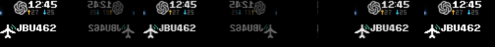
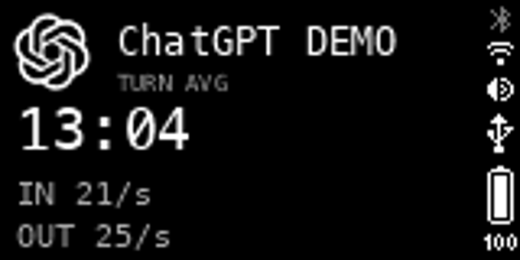

# Shared service motion

Cloud service changes use one control-plane transition, independent of app,
template or priority group. The target is a 200 ms fade to black followed by a
200 ms black hold. The phase clock uses monotonic elapsed time, with persisted
progress as a lower bound after eviction. A delayed scheduler samples the
current opacity instead of replaying every missed frame. The black hold starts
after an opaque native draw is acknowledged. Device HTTP latency and retries can
extend these target durations; the WAN API cannot guarantee exact physical
200 ms intervals.

| Event | Behavior |
| --- | --- |
| Natural end or rotation | Stop charging the outgoing dwell budget; exit, black, then enter the next candidate. |
| Higher group preempts | Change the pending candidate immediately. Reuse an exit already in progress, so candidate churn does not restart 400 ms. |
| Interrupted service resumes | Keep its remaining dwell budget, and run a fresh entrance before charging it. |
| Queue becomes empty | Finish exit and black before clearing this application's namespace and returning to the device default. |
| Same occurrence changes content | Keep the occurrence, generation and current entry; send the latest content delta. |
| Cold start | Enter directly; there is no outgoing content to fade. |

The compositor covers the 72×16 front and 160×80 back service canvas with black
XPM masks. Device-owned status icons may remain visible. Old native scrolling
text is neutralized under black, then selectively retired. Normal incoming draws
atomically make the masks transparent alongside the new content, so a delayed
retirement request cannot hide the whole entrance. Crowded scenes use the
bounded staged handoff. Existing generation, ownership and acknowledgement
fences still determine what counts as displayed.

All six current local registrations use the same 720 ms coin projection through
the common cloud scene adapter: Agent status, Agent requests, ADSBao, World of
Warcraft, WoW Forever and MapleStory. The full front turns about its vertical
axis twice, slows and stops on its normal readable face. The reverse is darker
and mirrored, and the edge remains at least one pixel wide. The pure projection
function takes elapsed seconds; the native asset samples it at 25 FPS. Entrance
completion is a duration/acknowledgement boundary, not a host frame counter.

Complete recovery scenes retain the entry asset for actual re-entry. A later
transparent replacement is the native renewal target, so a long-lived service
cannot restart its entrance during TTL renewal. Incremental value/clock updates
do not contain that entry asset. Reduced-motion local scenes remain static.
Third-party publishers that build their own scenes must provide their own entry
asset or adopt the shared adapter; the control-plane exit still covers them.
Standalone presenters retain their existing animations.

[Animated coin preview](images/shared-coin-preview.gif) ·
[Exit/black/entry visual preview](images/exit-black-coin-preview.gif)

These previews are synthetic time-curve illustrations, not measurements of WAN
latency. The ADSBao source and registration identity remain `adsbao`; its new
16×14 mark is a white top-view aircraft with jade radar arcs.

Codex's optional rate uses attributed per-turn usage and the corresponding
positive monotonic duration, labelled **TURN AVG** on the back display. It
includes tools, waiting, thinking, first-token latency and retries; output
reasoning is counted once. The parser change does not enable a new event feed
or grant session-directory access. See [supported Codex input fields](../apps/src/busybar_apps/codex/README.md).

## Controlled device preview before deployment

Temporary synthetic occurrences were sent through the existing binding and
withdrawn or confirmed terminal afterwards. This did not install the new observer
or control-plane code. Actual firmware captures confirmed native coin playback,
the new ADSBao mark, z-index 255 black masks on both service canvases, and the
synthetic Codex parser result (`938 / 37 s`, OUT 25/s) with its TURN AVG label.
Firmware-owned status icons remained visible alongside the black back canvas.

[Device coin capture](images/actual-service-coin.gif)

These captures establish asset/display compatibility. The new exit scheduler's
200/200 ms boundaries are verified with an injected monotonic clock and mocked
native acknowledgements; physical WAN transition timing still needs acceptance
after a reviewed deployment. The current Mac's real Codex event feed was not
accessible, so the synthetic rate does not establish live Codex throughput.
