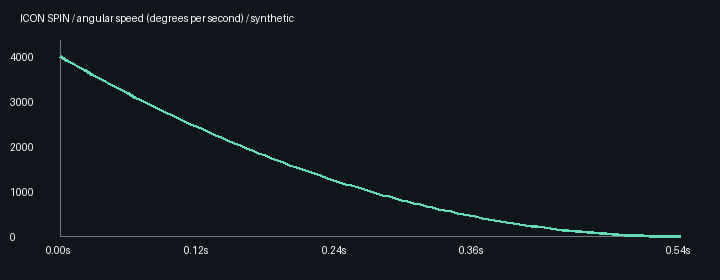
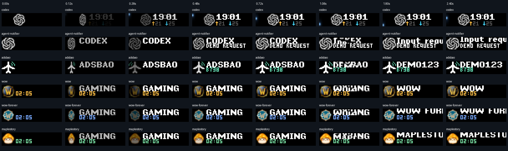
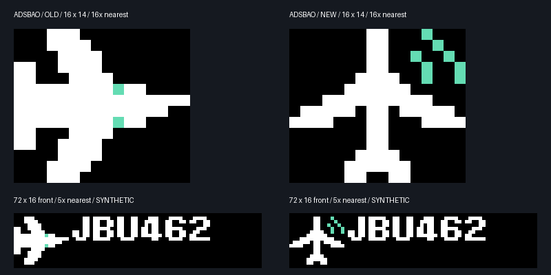
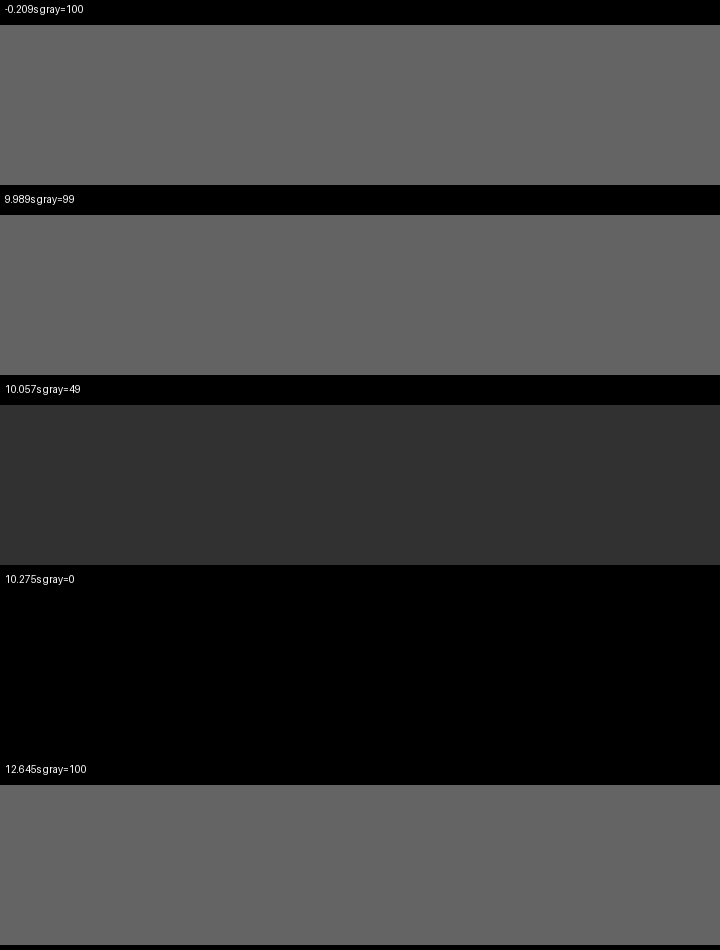
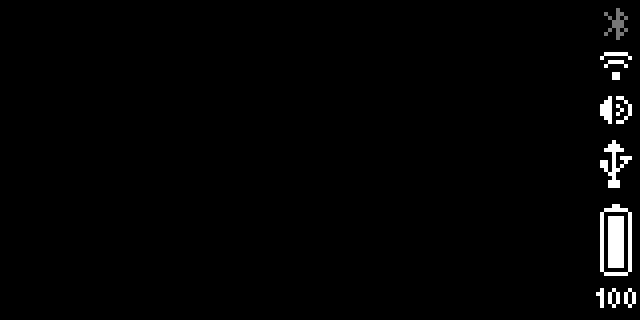

# Shared service motion

## Prepared local handoff

The six local animated service adapters declare `entryLeadMs: 200`. The control
plane keeps the outgoing picture visible while it reserves and uploads every
asset needed by the incoming scene, including two small native black/reveal
clips. One acknowledged native draw then hides obsolete widgets, starts the
incoming elements and starts both black clips. Ten frames at50FPS are black;
the next retained frame is transparent. The device reveals the already-loaded
scene without another HTTP request, upload, host timer or layer deletion.

Every non-looping first-command animation contains a200ms black prefix. Its
original selected RGB/RGBA raw/RLE frame records and frame rate are copied
byte-for-byte after that prefix. Later scene commands move by200ms, and any
first-command scrolling text gains200ms start delay. The original icon and text
entrances therefore start at reveal rather than playing away behind the mask.
At30FPS the six prefix frames use the firmware's33ms integer timer (198ms);
the separate50FPS compositor mask owns the200ms reveal boundary. Looping status
strips keep their existing assets and cadence.

The prepared path keeps the old picture until the incoming commit. It does not
start the previous WAN-controlled outgoing fade: the device API cannot both
fade the live old widgets and schedule an independent atomic scene switch in
one request. This avoids adding a network round trip after the screen is black.
When the queue becomes empty, a scoped DELETE keeps the old picture visible
until the device applies the return to its own default; no host black hold is
inserted before that request.

| Event | Prepared-path behavior |
| --- | --- |
| Natural end, rotation or preemption | Preload under the visible old scene; commit once; device black200ms then original entrance. |
| Interrupted service resumes | Keep its remaining dwell budget and start fresh non-loop native players. |
| Candidate changes during preparation | Discard obsolete pending generation commands; never commit a stale candidate. |
| Queue becomes empty | Return through the existing scoped clear without first hiding the old view. |
| Same occurrence changes content | Preserve generation and entrance; publish only the latest delta. |
| Cold/recovery entry | Preload first, then use the same local black/reveal commit. |

First-command non-loop animation IDs are materialized to generation-specific
native IDs. Updates, completion targets, renewal, recovery and acknowledgement
inventory use the same mapping; logical producer IDs remain stable. This avoids
reusing a finished same-path player without replaying entrances on ordinary
value updates. Old widgets become invisible in the commit itself, so a later
retirement DELETE cannot cover or postpone the new entrance.

The16-slot/two-MiB native file budget and64-entry/four-MiB cloud cache remain
unchanged. The current six local scene pairs plus both compositor files fit the
budget in regression tests. Missing compositor capacity falls back explicitly;
capacity that also prevents normal incoming/outgoing coexistence retains the
old inventory and retries with a bound, without clearing old files or claiming
the scene ready. Such capacity fallbacks are not a successful200ms transition.
Native TTL/source validity still bound how long old content can be retained.

The diagnostics implementation is `shared-service-motion-v2-prepared`.
`prepared_handoff` records the commit preparation boundary and pending upload
count. Native command acknowledgements separate `requestMs` from
`preRequestMs`, with fixed prepare/commit/retire stages. These contain no scene
content or private transcript data. API acknowledgement times are not physical
pixel timestamps.

A controlled hardware probe with fresh player IDs and explicit opacity captured
black followed by both public gray canvases using a single scene command and
no subsequent unmask draw. That probe extended the hold to1000ms so the LAN
sampler could observe it. The200ms probe restored gray but did not capture the
black interval; it does not prove physical200ms timing. Full prepared-path
hardware timing remains a separate post-deployment acceptance step.

Third-party scenes without `entryLeadMs: 200` retain the legacy outgoing
transition. The earlier fade/host-black path and inline-fence patch observed
multi-second actual black intervals; those observations are historical and do
not validate this prepared path. Reduced-motion adapters remain static.

## Icon and original text entrance

All six current local registrations use the same 540 ms coin projection through
the common cloud scene adapter: Agent status, Agent requests, ADSBao, World of
Warcraft, WoW Forever and MapleStory. Only the icon rectangle turns about its
vertical axis twice, slows and stops on its normal face. Agent icons occupy
14×14 pixels at (14,1); notification/game icons occupy 16×14 pixels at (0,1).
The service card, clock, counters and text never rotate. The reverse is darker
and mirrored, and the edge remains at least one pixel wide. The pure projection
function takes elapsed seconds; the native icon asset samples it at 50 FPS.
PR63 text motion remains independent: agent digit rolls and fades are unchanged;
notifications retain the original character entrance, detail at300ms after reveal and native
scrolling text. The notification entrance duration still follows its original
text sequence and can exceed the icon's 540 ms. Entrance completion uses the
scene duration/acknowledgement boundary, not a host frame counter.

The two-turn curve is θ(t)=4π(1−t/0.54)³, with angular speed
ω(t)=12π/0.54·(1−t/0.54)². Speed starts at 4000°/s and decreases
continuously to zero at 540ms. Sampling at50FPS uses the firmware's exact20ms
integer timer period. The largest adjacent angle change is about77.1° (below
90°), compared with about113.5° at the former25FPS/720ms setting; the fast
front/reverse/edge sequence is therefore better resolved without adding turns.
The two-turn16×14 raw body stays below26KiB; its prepared file including the
black prefix stays below34KiB. The asset/slot count and16-slot/two-MiB device
budget are unchanged.

| Time | Remaining angle | Angular speed |
| --- | ---: | ---: |
| 0ms | 720° | 4000°/s |
| 60ms | 505.7° | 3160.5°/s |
| 120ms | 338.8° | 2419.8°/s |
| 240ms | 123.5° | 1234.6°/s |
| 360ms | 26.7° | 444.4°/s |
| 480ms | 1.0° | 49.4°/s |
| 540ms | 0° | 0°/s |

The inspected firmware player schedules one frame callback using `1000/fps` and
pauses on its finished flag; the service layer still sends `loop:false` and
retains the transparent renewal target. That wrapper contains no frame-skipping
policy. Actual render cadence and any decoder-internal catch-up remain hardware
observations, not a guarantee from the encoded FPS or this preview.

Complete recovery scenes retain the entry asset for actual re-entry. A later
transparent replacement is the native renewal target, so a long-lived service
cannot restart its entrance during TTL renewal. Incremental value/clock updates
do not contain that entry asset. Reduced-motion local scenes remain static.
Third-party publishers that build their own scenes must provide their own entry
asset or adopt the shared adapter; scenes without the lead marker retain the legacy exit.
Standalone presenters retain their existing animations.

[Animated six-service icon and original text preview](images/icon-only-six-services.gif)

These previews compose the actual icon/text assets with synthetic timing and a
local approximation for firmware text widgets. Each sampled frame verifies that
the icon compositor changes no pixels outside its icon rectangle. They are not
measurements of WAN latency or physical device acceptance. The ADSBao source and registration identity remain `adsbao`; its new
16×14 mark is a white top-view aircraft with jade radar arcs.

Codex metadata access remains blocked and is outside this animation release.
The existing Codex unknown-rate behavior and PR63 reply-throughput fixes remain
unchanged. This release adds no data feed, hook or session-directory access.

## Historical hardware probes before prepared handoff

Temporary synthetic occurrences were sent through the existing binding and
withdrawn or confirmed terminal afterwards. This did not install the new observer
or control-plane code. Earlier firmware captures confirmed the previous full-front coin asset playback,
the new ADSBao mark and z-index 255 black masks on both service canvases.
Firmware-owned status icons remained visible alongside the black back canvas.

[Historical full-front coin capture, superseded](images/actual-service-coin.gif)

This historical capture does not validate the corrected icon-only entrance.
New icon-only hardware acceptance remains separate from these offline previews.

These captures establish asset/display compatibility. The new exit scheduler's
200/200 ms boundaries are verified with an injected monotonic clock and mocked
native acknowledgements; physical WAN transition timing still needs acceptance
after a reviewed deployment. These animation captures do not establish live
Codex throughput.

A revised native fade preview used two small RLE assets (front 526 B, back
4166 B), fresh widget IDs and explicit opacity-zero unmasking. The actual front
capture contained gray levels 100 → 99 → 49 → 0; the full back service region
also reached black, and unmasking restored gray 100. The screenshot request
itself sometimes took 218 ms, so these samples demonstrate intermediate dimming
and coverage rather than exact physical 200 ms timing. The seven asset samples
span 0…200 ms at 30 FPS. Device-owned status icons remained visible.

The earlier five-widget/raw-asset prototype failed actual-device checks (missing
back coverage and no captured intermediate dimming) and is not the final design.
A fresh-layer, slow-animation diagnostic showed all gray levels. Because that
probe changed both widget identity and initial alpha, it did not establish a
specific firmware alpha/cache defect. The final path conservatively starts at
alpha 1/255 and uses new IDs for each exit. Same-path section changes alone are
known not to restart the installed firmware's finished animation.
