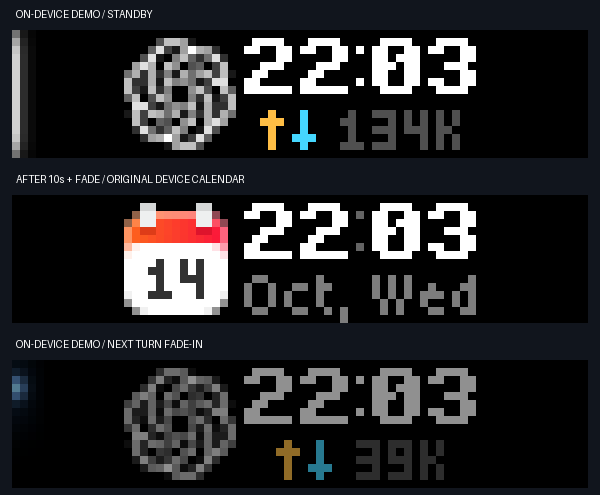
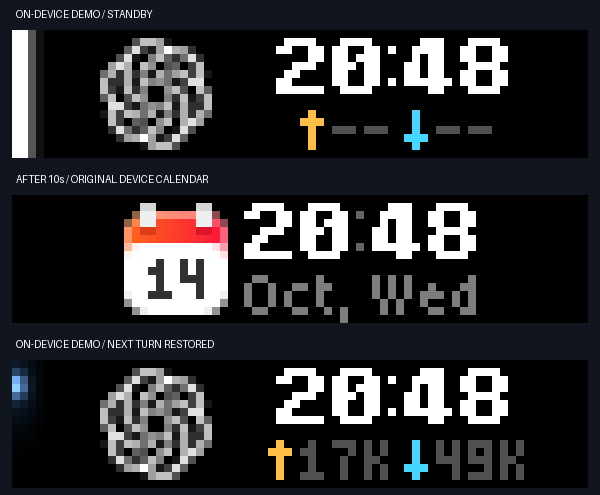

# Standby timeout — 2026-10-14

Completion, interruption, or no selected task enters full-height white standby. After ten seconds of successfully displayed standby, the observer removes only its own `ai-status` elements and the original firmware calendar reappears. Repeated refreshes and the done-to-idle transition do not restart this timer. Working/waiting cancels it. The timer uses a monotonic clock and is checked each observer poll, independently of the five-second drawing interval.

Calendar mode persists using the same turn latch as Start/Pause: old-turn updates cannot reclaim the screen; a newly active turn resumes Codex automatically.

Actual device acceptance used the production observer, real cloud API and real elapsed time with explicitly labeled finite DEMO lifecycle events. It measured **10.24 seconds** between the first successful standby draw and automatic calendar transition. Device framebuffers confirmed all three stages: white standby, original firmware calendar, and blue thinking after the next new turn. Visual inspection confirmed the original calendar returned and the next turn restored the approved Codex layout.

The motion-enabled observer was checked again on 2026-10-14. It holds standby
for ten seconds after the entrance reveal, then plays a 200 ms outgoing fade.
The cloud framebuffer confirmed the native calendar **11.012 seconds** after
the standby timer started. This measurement includes cloud requests and capture
sampling. A new task turn then restored the blue thinking display.

See the [motion guide](motion.md) for playback times and transition captures.

Unit and observer integration tests cover the exact ten-second boundary, refreshes that must not reset it, cancellation/rearming, no countdown before a successful draw, calendar persistence, and next-turn restoration. These tests supplement the actual timed device verification above.

Automatic return does not require a local input connection. Physical Start/Pause acceptance is tracked separately in [button-calendar.md](button-calendar.md).
