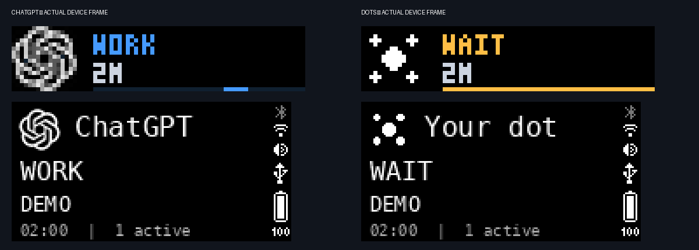
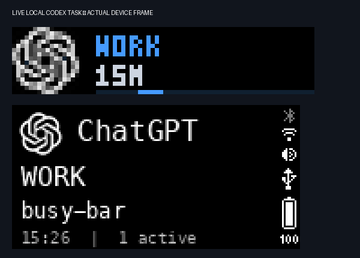

# Verification — 2026-10-14

- Local unittest suite: 48 tests, all passed on Python 3.14 / Pillow 12.3.
- BUSY device status: HTTP 200; firmware 1.2.4, API 27.5.0.
- Authenticated Python client: identifies itself as `busy-bar-status/0.1`; the cloud rejected the default Python urllib user agent, so generic HTTP 403 must not alone be treated as proof of a bad token during troubleshooting.
- Keychain: authorized by the user through the native system dialog; token read through `/usr/bin/security`, never committed or logged.
- ChatGPT WORK demo: POST display 200, front frame 200, back frame 200.
- Original Your dot WAIT demo: POST display 200, front frame 200, back frame 200.
- Selective cleanup: DELETE display with `application_name=ai-status`, HTTP 200.
- Actual frame format: front BGR888 (3456 bytes); back packed L4 (6400 bytes, low nibble first). Both decoders have regressions. The back screen retains the firmware's right-hand status overlay.
- Visual inspection: both marks are distinguishable; state labels, colors, project and time fit their screens. No clipped status labels observed.
- Actual local lifecycle: bootstrap observed the originating busy-bar session as working, project `busy-bar`, one active task. Background service rendered that real state; both framebuffers were read back.
- LaunchAgent: loaded and running under the current user's GUI session, automatically starts at login. Log records actual working transition. No Codex hooks, hook trust records, device timers, brightness or audio settings changed.
- Cloud-only Your dot status: **not automatically connected**. Explicit Orbit identity classification and metadata event bridge provided; cached profile status is never used as task state. Dots WAIT screenshot is labeled DEMO on the device.
- Reinstall race: launchd may report transient EIO immediately after bootout; installation retries only that local teardown condition for up to 25 seconds, covering an in-flight request and scoped final cleanup. Regression test and live reinstall passed.
- Linux log replacement: same-inode equal/larger rewrites and restored mtime are detected by metadata and a digest of the previously consumed tail; deterministic regression tests passed.
- Actual completion of the originating conversation occurs after this report is written. Completion/interrupt, waiting correlation and expiration are covered by synthetic lifecycle regressions; no claim of a live completed conversation test is made.

