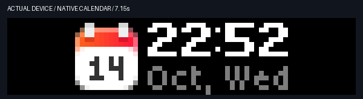

# Bold flight identity and weighted motion — 2026-10-14

The flight identity now uses the same native Bold7 font as the clock.
The title is seven pixels high. The distance and type keep their compact five-pixel
line. The aircraft and text remain centered as one group.
An unusually wide eight-character identity is compressed to 55 pixels in width.
Its full identity and the 16-pixel aircraft still fit the 72-pixel display.

The user selected damped settling without overshoot.
Clock and rate rolls now use a critically damped step response.
They accelerate, make their main movement, then slow into the target.
The roll lasts 400 ms. Fractional pixel coverage removes whole-row stepping.
The first and last frames contain the exact original glyphs.

The flight identity uses the same roll sampler when it enters.
The aircraft uses the same progress curve for its horizontal movement.
Its complete entrance takes 500 ms. The ten-second hold starts after that entrance.
Reduced-motion mode keeps static glyphs and a static aircraft.

The thinking light follows a cosine position cycle.
It reaches zero speed at each endpoint, then accelerates in the reverse direction.
The travel remains from row 1 to row 14, with a 92-frame round trip at 30 fps.
A small halo lag follows its direction of travel.
State colors and calendar return rules stay the same.

## Inspect the motion

The following files are software renderings of the production assets.
They show the 30 fps frame sequence without cloud delays.

- [Codex transitions and blue light](images/weighted-motion-preview.gif).
- [Bold aircraft entrance](images/weighted-flight-preview.gif).

The actual-device mock capture contains 53 framebuffer samples.
Visual inspection confirmed the bold identity, glyph changes, light states,
Codex restoration, and native calendar restoration.
The demo uses synthetic flight, clock, and rate values; its back display says DEMO.

Cloud sampling is about two frames per second.
It does not measure native playback frame rate or resolve every easing frame.
The offline preview shows those intermediate frames.
Cloud transport can add a pause between fade-out and the next display update.

## Validation

All 160 local tests passed.
New checks cover damping, monotonic progress, exact glyph endpoints,
fractional coverage, endpoint speed, smooth reversal, native bold letters,
and the widest eight-character identity.
Existing checks cover native file limits, display ownership, static mode,
button dismissal, retry delays, and restoration.

Changed assets use `motion-v2`, `thinking-v4`, and `adsbao-entry-v2` names.
This prevents a running native player from keeping the old asset source.
