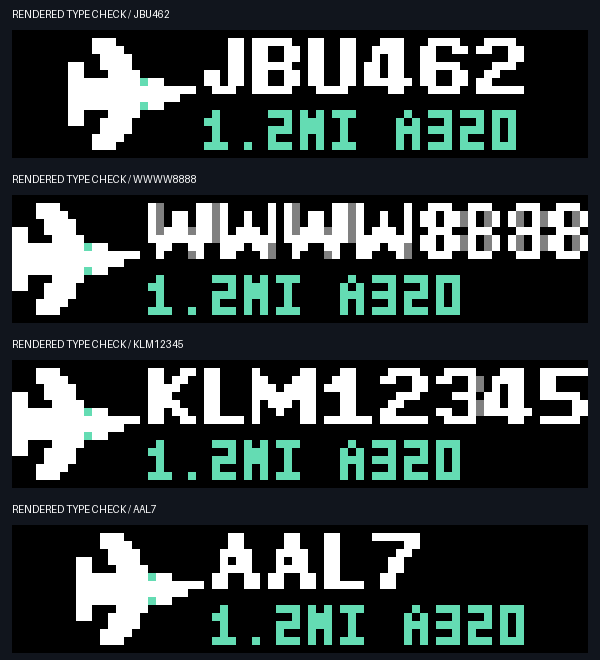
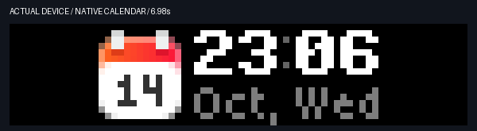
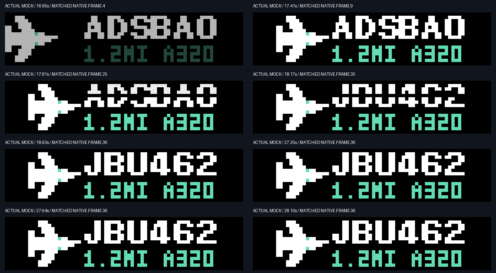

# Bold flight identity and weighted motion — 2026-10-14

The flight identity now uses the same native Bold7 font as the clock.
The title is seven pixels high. The distance and type keep their compact five-pixel
line. The aircraft and text remain centered as one group.
An unusually wide eight-character identity is compressed to 55 pixels in width.
Its full identity and the 16-pixel aircraft still fit the 72-pixel display.

The user selected damped settling without overshoot.
Clock and rate rolls now use a critically damped step response.
They accelerate, make their main movement, then slow into the target.
The roll lasts 500 ms. Its slower half retains more visible travel than the first
version. Fractional pixel coverage removes whole-row stepping.
The first and last frames contain the exact original glyphs.

The aircraft uses the same progress curve for its horizontal movement.
It enters in 300 ms. The title holds `ADSBAO` for 500 ms, then flips to the flight
identity in 400 ms. The shared split-flap sampler closes the old upper half,
then opens the new lower half. A dark hinge and shaded moving face show the turn.
The complete introduction takes 1.2 seconds. The ten-second hold starts afterward.
Reduced-motion mode keeps static glyphs and a static aircraft.

The thinking light uses a quintic position curve for each stroke.
It pauses for 400 ms across each endpoint, then accelerates through the middle.
Acceleration and speed both reach zero at each hold boundary.
The travel remains from row 1 to row 14, with a 92-frame round trip at 30 fps.
A small halo lag follows its direction of travel.
State colors and calendar return rules stay the same.

## Inspect the motion

The following files are software renderings of the production assets.
They show the 30 fps frame sequence without cloud delays.

- [Codex transitions and blue light](images/weighted-motion-preview.gif).
- [ADSBAO split-flap entrance](images/split-flap-flight-preview.gif).

The latest actual-device mock capture contains 60 framebuffer samples.
Visual inspection confirmed the brand, both flip phases, bold identity, glyph
changes, light states, Codex restoration, and native calendar restoration.
Captured introduction frames match the generated native frames exactly.
After the final title appears, all matching hold samples remain on that final
frame, including after the five-second display refresh.
The demo uses synthetic flight, clock, and rate values; its back display says DEMO.

Cloud sampling is about two frames per second.
It does not measure native playback frame rate or resolve every easing frame.
The offline preview shows those intermediate frames.
Cloud transport can add a pause between fade-out and the next display update.

## Validation

All 164 local tests passed.
New checks cover damping, monotonic progress, exact glyph endpoints,
fractional coverage, endpoint speed, smooth reversal, native bold letters,
and the widest eight-character identity.
Existing checks cover native file limits, display ownership, static mode,
button dismissal, retry delays, and restoration.

Changed assets use `motion-v3`, `thinking-v5`, and `adsbao-entry-v3` names.
This prevents a running native player from keeping the old asset source.
The clock atlas is 205,437 bytes. The aircraft introduction is 124,636 bytes.
Both fit the 255 KiB file limit.

Firmware initially selects a looping default range when it loads a new file.
The introduction explicitly selects `enter` with `await_previous_end: false`.
Waiting for that default range would play the introduction twice before holding.
The actual capture checks this handoff as well as the final title.
